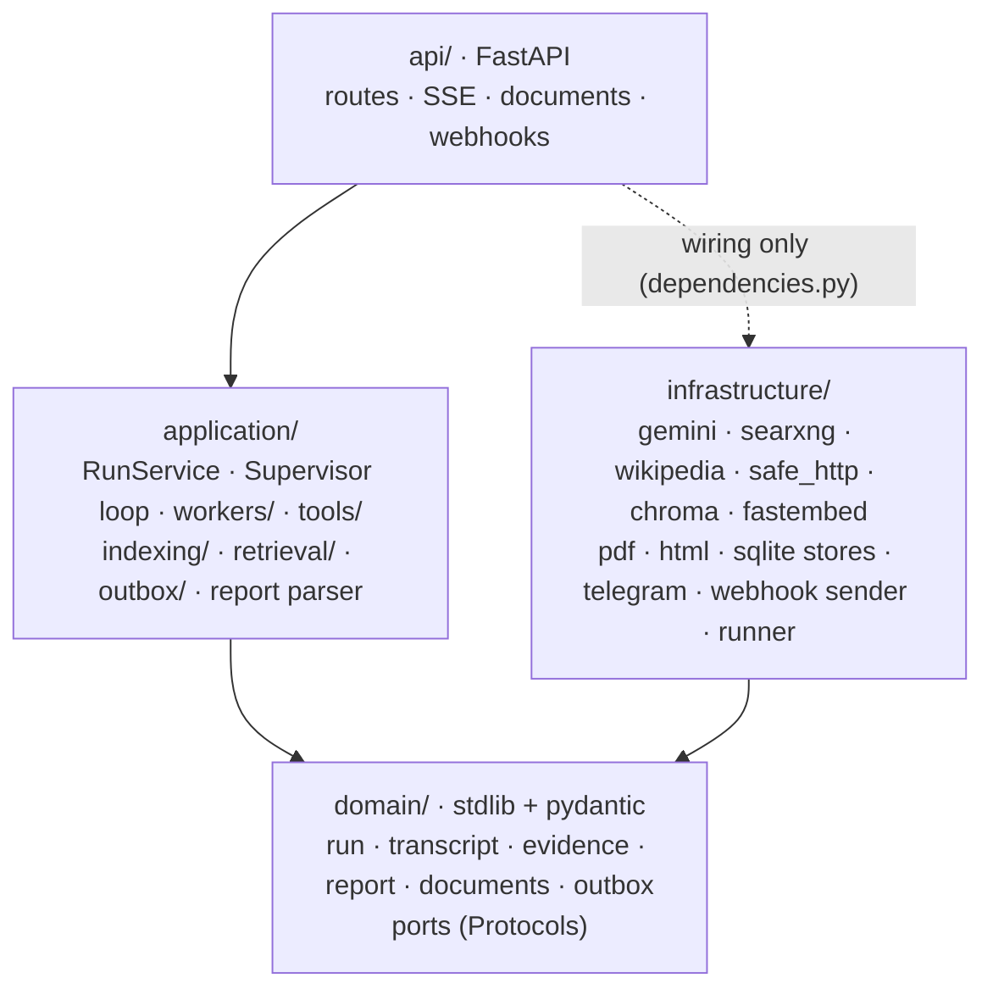

# Final Project — Backend Plan

Detailed backend design for [PLAN.md](PLAN.md). Decisions and their rationale are in [BRAINSTORM.md](BRAINSTORM.md).

**This plan is the contract between parallel work.** Sections marked 🔒 define the **shared contracts**: types, ports, schemas, configuration, tables and file ownership. They are implemented first, locally, as code (phase 1). The detailed plans (`plans/…`) and the cloud sessions that implement them build **on** these contracts and **must not change them silently**. A needed change goes into the PR description and gets approved here first (§22).

## 1. Scope

| In this plan | In the detailed plans |
|---|---|
| Layers, file layout, ownership | Supervisor prompt and loop changes → `plans/agents/SUPERVISOR_PLAN.md` |
| Domain types, ports, evidence and citation format | Researcher tool loop and prompts → `plans/agents/RESEARCHER_PLAN.md` |
| Run, report, transcript and conversation history shapes | Report Markdown format, report parser → `plans/agents/WRITER_PLAN.md` |
| Tools interface, retrieval and indexing interfaces | Reviewer + Fact-Checker → `plans/agents/REVIEWER_PLAN.md` |
| API endpoints, request and response schemas, SSE events, errors | SearXNG adapter, page reading, SSRF guard → `plans/tools/SEARXNG_TOOL_PLAN.md` |
| Configuration, SQLite tables, Chroma layout | Chunkers, PDF, embeddings, retrieval, documents, memory → `plans/tools/RAG_PLAN.md` |
| Budgets, limits, LLM wiring, service level | Telegram, `callback_url`, outbox dispatcher → `plans/integrations/WEBHOOKS_PLAN.md` |
| Test strategy, fakes, implementation order, deploy | |

## 2. Stack and reuse

- **Python 3.12** (pinned; cloud images default to 3.13). FastAPI, Pydantic v2, SQLite (WAL).
- **LLM:** `google-genai` through the Module 5 adapter.
- **RAG:** `chromadb==1.5.9`, `fastembed==0.8.1` (Module 4 pins).
- **New dependencies,** pinned in phase 0: `pypdf` (PDF text), `python-multipart` (uploads), and one HTML → text/Markdown extractor chosen in `SEARXNG_TOOL_PLAN.md` (candidates: `trafilatura`, `readability-lxml` + `markdownify`).
- **HTTP:** `httpx` for Wikipedia, SearXNG, page fetching, Telegram and webhooks. No Telegram SDK: the Bot API is three plain HTTP calls.

Reused code is **copied and adapted**, never imported across repositories:

| From | Files | How |
|---|---|---|
| M5 | `domain/ports.py` (LLM types), `infrastructure/gemini_client.py`, `llm_decorators.py`, `caching_llm.py`, `demo_llm.py`, `application/structured.py`, `budget.py`, `security.py` (InputValidator, DataFence, OutputValidator, canary), `stats.py`, `tracing.py`, `service_level.py`, `api/problems.py`, `api/guards.py`, `infrastructure/runner.py`, `database.py`, `wikipedia.py` + `fake_wikipedia.py`, `domain/protocol.py` | As-is. Small renames only |
| M5 | `domain/run.py`, `domain/transcript.py`, `application/runs.py`, `supervisor.py`, `context.py`, `memory.py`, `workers/*`, `api/routes.py`, `schemas.py`, `dependencies.py`, `config.py`, `prompts/` | **Adapted** (§5–§13) |
| M4 | `infrastructure/fastembed_models.py`, `application/embedding.py` (embedding cache), `chroma_store.py`, `retrieval/bm25.py`, `retrieval/fusion.py`, `chunking/markdown.py`, `chunking/splitting.py`, `application/evaluation/*` (metrics, judge, sanity check) | Adapted: `codebase` → `scope`, BM25 statistics **per scope**, a prose tokenizer mode, chunk type generalized (§7) |
| M4 | `chunking/python_ast.py`, `typescript.py`, tree-sitter deps | **Dropped** |
| M3/M5 | Architecture tests, Ruff config, pytest layout, cassette tests, eval harness | As-is, extended rules (§19) |

## 3. Layers



The rules, enforced by architecture tests (§19):
- **`domain`** imports only the stdlib and Pydantic.
- **`application`** never imports `infrastructure`, `api`, FastAPI, `httpx`, `sqlite3`, `chromadb` or `fastembed`.
- **`workers/`** never import `indexing/` or the vector store directly. They reach the index **only** through `tools/`.

## 4. 🔒 File layout and ownership

`Owner` = the plan/cloud task that may change the file after phase 1. **Shared** files change only through §22.

```
backend/
├── app/
│   ├── main.py                       Shared (wiring, lifespan, middleware)
│   ├── config.py                     Shared (§6)
│   ├── domain/
│   │   ├── ports.py                  Shared (§8)
│   │   ├── run.py                    Shared (§5.1)
│   │   ├── transcript.py             Shared (§5.2)
│   │   ├── evidence.py               Shared (§5.3)
│   │   ├── report.py                 Shared (§5.4)
│   │   ├── documents.py              Shared (§5.5)
│   │   ├── outbox.py                 Shared (§5.6)
│   │   ├── depth.py                  Shared (§5.7)
│   │   ├── protocol.py               SUPERVISOR
│   │   ├── schemas.py                REVIEWER (Review, FactCheck models)
│   │   └── errors.py                 Shared (new errors added in phase 1)
│   ├── application/
│   │   ├── runs.py                   Shared (RunService)
│   │   ├── supervisor.py  context.py SUPERVISOR
│   │   ├── memory.py                 RAG (hybrid MemoryStore)
│   │   ├── report.py                 WRITER (parse_report)
│   │   ├── citations.py              Shared (§9)
│   │   ├── workers/base.py           Shared (Worker, WorkerContext, registry)
│   │   ├── workers/researcher.py     RESEARCHER
│   │   ├── workers/writer.py         WRITER
│   │   ├── workers/reviewer.py  fact_checker.py   REVIEWER
│   │   ├── tools/base.py             Shared (Tool, ToolContext, ToolOutput, ToolRegistry)
│   │   ├── tools/web.py              SEARXNG (search_web, read_result)
│   │   ├── tools/wikipedia.py        SEARXNG (search_wikipedia)
│   │   ├── tools/documents.py        RAG (search_documents)
│   │   ├── indexing/                 RAG (Indexer, chunkers, extraction orchestration)
│   │   ├── retrieval/                RAG (Retriever, bm25, fusion)
│   │   ├── documents.py              RAG (DocumentService: upload, list, delete, purge)
│   │   ├── outbox/                   WEBHOOKS (dispatcher, payloads, signing)
│   │   ├── telegram.py               WEBHOOKS (TelegramService: updates → RunService)
│   │   ├── budget.py  security.py  structured.py  stats.py  tracing.py  service_level.py  prompts.py   Shared (M5)
│   ├── prompts/                      VERSION Shared · supervisor*.md SUPERVISOR · workers/<name>.md its worker's owner
│   ├── infrastructure/
│   │   ├── gemini_client.py  llm_decorators.py  caching_llm.py  runner.py   Shared (M5)
│   │   ├── demo/                     v1.1: the fake LLM split per agent: __init__.py (router) Shared · supervisor.py SUPERVISOR · researcher.py RESEARCHER · writer.py WRITER · reviewer.py REVIEWER
│   │   ├── database.py  sqlite_store.py   Shared (all DDL in phase 1, §16)
│   │   ├── wikipedia.py  fake_wikipedia.py      SEARXNG
│   │   ├── searxng.py  fake_search.py           SEARXNG
│   │   ├── safe_http.py                         SEARXNG (SSRF guard, used by WEBHOOKS too)
│   │   ├── html_extract.py                      SEARXNG
│   │   ├── chroma_store.py  memory_vector_store.py  fastembed_models.py  hashing_embedder.py  pdf_extract.py   RAG
│   │   ├── document_store.py  embedding_cache.py   RAG
│   │   ├── telegram_client.py  fake_telegram.py  webhook_sender.py  outbox_store.py   WEBHOOKS
│   └── api/
│       ├── routes.py  schemas.py  dependencies.py  problems.py  guards.py   Shared
│       ├── documents.py              RAG
│       └── webhooks.py               WEBHOOKS
├── samples/runs/                     stored replayable runs (phase 7)
├── samples/library/                  RAG (demo library + LICENSES.md)
├── eval/                             phase 7 (dataset owned by RAG for retrieval, Shared for runs)
└── tests/
    ├── fakes.py                      Shared (§19.2): extend only by adding, never changing existing fakes
    ├── test_architecture.py          Shared
    └── unit/ component/ api/ integration/   each owner adds files named after its area
```

## 5. 🔒 Domain model

### 5.1 The run (`domain/run.py`, adapted from M5 `ResearchRun`)

Kept from Module 5:
- the status machine (`queued` → `running` → `awaiting_approval` / `completed` / `failed` / `cancelled`)
- every mutation emits a `RunEvent`
- the repository saves state + new events **atomically**
- the approval flow, flags, memories, call and token counters

Changes:

| Field | Type | Note |
|---|---|---|
| `question` | `str` | Renamed from `task` (matches the API) |
| `depth` | `Depth` | `brief` · `detailed` · `technical` (§5.7) |
| `sources` | `frozenset[SourceKind]` | Allowed tool families: `web`, `wikipedia`, `documents` |
| `workspace_id` | `str \| None` | Set when the request had `X-Workspace-Id` and `documents` is allowed |
| `channel` | `Channel` | `web` · `api` · `telegram` |
| `subscribers` | `list[Subscriber]` | §5.6. Who is notified when the run ends |
| `evidence` | `list[EvidenceRef]` | §5.3. The run's numbered evidence, in order of first use (replaces M5 `sources`) |
| `tool_calls` | `int` | Count, for metrics. Details live in the transcript |
| `report` | `Report \| None` | §5.4. Set with `final_output` on completion |
| `final_output` | `str \| None` | The final Markdown (kept: the approval draft and the replay UI use it) |
| `outbox` | `list[OutboxMessage]` | New, **not yet persisted** messages (like `events`). Saved in the same transaction as the state (§13) |

**New methods** (names fixed, behavior detailed in the owning plan):
- `add_evidence(chunks) -> list[EvidenceRef]`: numbers new chunks and returns refs. Already-known chunk ids keep their number.
- `record_tool_call(record: ToolCallRecord, meta: CallMeta)`
- `set_report(report)`
- `queue_outbox(message)`

**Notifications:** `_complete`, `fail` and `cancel` call `self._notify(event_type)`, which queues one `OutboxMessage` per subscriber.

### 5.2 Transcript (`domain/transcript.py`)

M5 `TranscriptEntry`, `Decision`, `Delegation`, `WorkerResult` and `CallMeta` are kept. Changes:
- `EntryKind` gains **`TOOL_CALL = "tool_call"`**.
- `TranscriptEntry` gains `tool: ToolCallRecord | None = None`.
- `WorkerResult.source_ns` is **renamed `evidence_ns: tuple[int, ...]`**: the evidence numbers this result cites.
- `Source` is **removed** (replaced by `EvidenceRef`).

```python
@dataclass(frozen=True)
class ToolCallRecord:
    worker: str                 # "researcher" (the only tool user today)
    tool: str                   # search_web | search_wikipedia | search_documents | read_result
    args: dict[str, Any]        # e.g. {"query": "..."} or {"evidence_id": "E3"}; ≤ 500 chars total
    status: Literal["ok", "empty", "error", "refused", "capped"]
    provider: str | None        # "searxng" | "wikipedia" | "documents" | "web-page"
    fallback: str | None        # e.g. "wikipedia" when SearXNG failed
    results: int                # hits returned by the provider
    evidence_ns: tuple[int, ...]  # evidence numbers given to the model
    error: str | None           # short reason, never a stack trace
    duration_ms: int
```

### 5.3 Evidence (`domain/evidence.py`)

The unit stored, searched and cited:

```python
class SourceKind(StrEnum):
    WEB = "web"; WIKIPEDIA = "wikipedia"; DOCUMENTS = "documents"

@dataclass(frozen=True)
class EvidenceChunk:            # what the index stores (one Chroma record)
    id: str                     # sha256(scope, source_key, position, content_hash)[:24]
    scope: str                  # §7.1: "run:<id>" | "ws:<id>" | "demo" | "memory"
    source_kind: SourceKind
    source_key: str             # URL, "wikipedia:<page_id>", "doc:<document_id>", "run:<id>" (memory)
    title: str
    url: str | None             # web, wikipedia
    document_id: str | None     # documents
    document_name: str | None
    page: int | None            # PDF page (1-based)
    heading: str | None         # "Guide > Setup"
    position: int               # order within the source
    text: str                   # what the model sees
    content_hash: str
    retrieved_at: str           # ISO-8601 UTC

@dataclass(frozen=True)
class EvidenceRef:              # a chunk numbered within ONE run
    n: int                      # 1, 2, 3 … → cited as [E1], [E2] …
    chunk_id: str
    source_kind: SourceKind
    title: str
    url: str | None
    document_name: str | None
    page: int | None
```

**`EvidenceRef` holds no text.** The Writer and Fact-Checker load the text through the `Retriever.get(chunk_ids)` port. Evidence text never appears in the API, except as a short `snippet` (≤ 300 characters) in the references.

### 5.4 Report (`domain/report.py`)

```python
@dataclass(frozen=True)
class ReportSection:
    heading: str
    content: str                # Markdown, keeps [E…] citations

@dataclass(frozen=True)
class Reference:
    id: str                     # "E3"
    title: str
    url: str | None
    document_name: str | None
    page: int | None
    source_kind: SourceKind
    snippet: str                # ≤ 300 chars

@dataclass(frozen=True)
class Report:
    title: str
    summary: str
    sections: tuple[ReportSection, ...]
    references: tuple[Reference, ...]   # only cited evidence, in order of first citation
    depth: Depth
    word_count: int
```

`parse_report(markdown: str, evidence: list[EvidenceRef], *, question: str = "", depth: Depth = Depth.DETAILED, snippets: Mapping[int, str] | None = None) -> Report` (signature v1.1, §24) lives in `application/report.py` (WRITER). It is **deterministic**: the first `# ` heading is the title, the paragraph(s) before the first `## ` are the summary, each `## ` starts a section, and a trailing "Sources"/"References" section is dropped and rebuilt from the cited evidence. Fallbacks: no title → the question; no summary → the first sentence of the first section. It **never raises**.

### 5.5 Documents (`domain/documents.py`)

```python
class DocumentStatus(StrEnum):
    INDEXING = "indexing"; READY = "ready"; FAILED = "failed"

@dataclass
class Document:
    id: str                     # "doc_" + 12 hex
    workspace_id: str           # or "demo"
    name: str                   # sanitized file name, ≤ 120 chars
    media_type: str             # text/markdown | text/plain | application/pdf
    size_bytes: int
    sha256: str                 # duplicate upload in the same workspace → the existing document
    status: DocumentStatus
    pages: int | None
    chunks: int
    error: str | None           # short, user-safe
    created_at: str
    expires_at: str | None      # None for demo

@dataclass
class Workspace:
    id: str                     # the X-Workspace-Id value
    created_at: str
    expires_at: str             # created_at + WORKSPACE_TTL_H
    bytes_used: int
    documents: int
```

**Workspace ids** are random UUIDv4 values created by the browser (`crypto.randomUUID()`) and used as capability tokens. The API rejects any other format (`invalid-workspace`).

**The original upload bytes are not kept:** they are extracted, chunked and discarded.

### 5.6 Subscribers and outbox (`domain/outbox.py`)

```python
class Channel(StrEnum):
    WEB = "web"; API = "api"; TELEGRAM = "telegram"

@dataclass(frozen=True)
class Subscriber:
    kind: Literal["callback", "telegram"]
    target: str                 # callback URL | Telegram chat id
    secret: str | None          # always None (v1.1, §24): the callback secret is DERIVED, never stored

class OutboxStatus(StrEnum):
    PENDING = "pending"; DELIVERED = "delivered"; DEAD = "dead"

@dataclass
class OutboxMessage:
    id: str                     # "msg_" + 24 hex; also the Standard Webhooks `webhook-id`
    run_id: str
    kind: Literal["callback", "telegram"]
    event: str                  # research.accepted | research.completed | research.failed | research.cancelled
    target: str
    payload: dict[str, Any]     # routing only ({"chat_id"} or {}); the body is rendered at SEND time (v1.1, §24)
    status: OutboxStatus = OutboxStatus.PENDING
    attempts: int = 0
    next_attempt_at: str = ""   # ISO-8601 UTC
    last_error: str | None = None   # short, no secrets
    created_at: str = ""
    delivered_at: str | None = None
```

**`research.accepted`** goes to Telegram only (the "working on it" reply). It is queued by `RunService.submit` in the same transaction that creates the run.

### 5.7 Depth (`domain/depth.py`)

```python
class Depth(StrEnum):
    BRIEF = "brief"; DETAILED = "detailed"; TECHNICAL = "technical"

@dataclass(frozen=True)
class DepthProfile:
    words: tuple[int, int]      # target range for the report body
    sections: tuple[int, int]
    default_max_iterations: int
    guidance: str               # one paragraph for the Supervisor and Writer prompts

PROFILES = {
    Depth.BRIEF:     DepthProfile((200, 400), (2, 3), 4, "..."),
    Depth.DETAILED:  DepthProfile((600, 1000), (4, 6), 5, "..."),
    Depth.TECHNICAL: DepthProfile((800, 1400), (5, 7), 6, "precise terms, examples, official sources first"),
}
```

The guidance texts are written in `WRITER_PLAN.md`. The numbers above are the contract.

## 6. 🔒 Configuration (`config.py`)

M5 `Settings` is kept. **New or changed** environment variables (defaults are for production; tests override them):

| Variable | Default | Meaning |
|---|---|---|
| `DATABASE_PATH` | `research.db` (Railway: `/data/research.db`) | SQLite |
| `CHROMA_PATH` | `chroma` (`/data/chroma`) | ChromaDB persistent dir |
| `MODELS_PATH` | `models` (`/data/models`) | fastembed model cache (download once) |
| `EMBED_MODE` | `onnx` (`fake` in tests) | `fake` = deterministic hashing embedder (M4) |
| `EMBED_MODEL` | `BAAI/bge-small-en-v1.5` | 384 dims |
| `RERANK_MODEL` | `""` | Empty = reranker off (Railway). Local eval may set M4's MiniLM |
| `ONNX_THREADS` · `EMBED_BATCH_SIZE` | `2` · `4` | M4 memory tuning |
| `CHUNK_MAX_CHARS` · `CHUNK_MIN_CHARS` · `CHUNK_OVERLAP` | `1400` · `400` · `0.15` | Chunking |
| `EVIDENCE_TOP_K` | `6` | Chunks returned per tool call |
| `EVIDENCE_SNIPPET_CHARS` | `900` | Max chars of each chunk shown to the Researcher |
| `SEARCH_MODE` | `live` (`fake` when `LLM_MODE=fake`) | SearXNG adapter or fake |
| `SEARXNG_URL` | `http://searxng.railway.internal:8080` | Private network |
| `SEARCH_MAX_RESULTS` · `SEARCH_TIMEOUT_S` · `SEARCH_CACHE_TTL_H` | `8` · `8` · `24` | |
| `FETCH_TIMEOUT_S` · `FETCH_MAX_BYTES` · `FETCH_MAX_REDIRECTS` | `10` · `2000000` · `3` | `read_result` and webhooks |
| `RESEARCHER_MAX_TOOL_CALLS` | `3` | The cap (code, not prompt) |
| `DEFAULT_DEPTH` | `detailed` | |
| `UPLOAD_MAX_BYTES` · `PDF_MAX_PAGES` | `5242880` · `150` | Per file |
| `WORKSPACE_MAX_DOCS` · `WORKSPACE_MAX_BYTES` · `WORKSPACE_TTL_H` | `10` · `20971520` · `24` | |
| `DEMO_LIBRARY_PATH` | `samples/library` | Seeded into scope `demo` at startup (skips unchanged files) |
| `RATE_LIMIT_UPLOADS_PER_HOUR` | `10` | Per IP |
| `TELEGRAM_MODE` | `off` (`fake` in tests) | `live` · `fake` · `off`. `off` → the webhook route answers 404 |
| `TELEGRAM_BOT_TOKEN` · `TELEGRAM_WEBHOOK_SECRET` | — | Secrets, set by the user |
| `TELEGRAM_ALLOWED_CHATS` | `""` | Comma-separated chat ids. Empty = nobody |
| `TELEGRAM_RUNS_PER_DAY` | `10` | Per chat |
| `FRONTEND_URL` | `http://localhost:3000` | Public UI base for links (`{FRONTEND_URL}/?run={id}`) |
| `OUTBOX_POLL_S` · `OUTBOX_MAX_ATTEMPTS` · `WEBHOOK_TIMEOUT_S` | `1` · `6` · `10` | |
| `CALLBACK_ALLOW_PRIVATE` | `false` | Tests/local only: lets `callback_url` target localhost |
| `LLM_RUN_BUDGET_PER_ITERATION` · `LLM_RUN_BUDGET_BASE` | `3` · `5` | Budget = `3 × iteration_limit + 5` (§12) |

**Removed:** `WIKI_MAX_PAGES` stays, but the M5 Researcher's `Topics:` query logic moves into `search_wikipedia` (SEARXNG).

## 7. 🔒 RAG contracts

### 7.1 Scopes

| Scope string | Content | Written by | Read by |
|---|---|---|---|
| `run:<run_id>` | Evidence gathered during the run | Tools (via `Indexer`) | Researcher tools, Writer, Fact-Checker |
| `ws:<workspace_id>` | The browser's uploads | `DocumentService` (via `Indexer`) | `search_documents` |
| `demo` | The demo library | Startup seeding | `search_documents` |
| `memory` | One chunk per completed run's report summary | `MemoryStore.record` | Supervisor (`MemoryStore.recall`) |

One Chroma collection per embedding model (M4 `collection_name(model)`), filtered with `where: {"scope": {"$in": scopes}}`. BM25 keeps **one index per scope**, so statistics never mix across scopes.

### 7.2 Ports (in `domain/ports.py`)

```python
class Embedder(Protocol):                       # M4 unchanged
    name: str; dim: int; max_tokens: int
    def embed_documents(self, texts: list[str]) -> list[list[float]]: ...
    def embed_query(self, text: str) -> list[float]: ...

class VectorStore(Protocol):                    # M4, codebase → scope
    def upsert(self, chunks: list[EvidenceChunk], vectors: list[list[float]]) -> None: ...
    def query(self, vector: list[float], scopes: list[str], n: int) -> list[tuple[str, float]]: ...
    def get(self, ids: list[str]) -> list[EvidenceChunk]: ...
    def iter_chunks(self, scope: str) -> Iterator[EvidenceChunk]: ...
    def delete_scope(self, scope: str) -> int: ...
    def delete_source(self, scope: str, source_key: str) -> int: ...
    def count(self, scope: str | None = None) -> int: ...

class EmbeddingCache(Protocol): ...             # M4 unchanged

@dataclass(frozen=True)
class SourceText:                               # input to indexing: one fetched/extracted source
    scope: str
    source_kind: SourceKind
    source_key: str
    title: str
    text: str                                   # Markdown or plain text
    url: str | None = None
    document_id: str | None = None
    document_name: str | None = None
    pages: tuple[tuple[int, int], ...] = ()     # (page number, start offset) for PDFs

class Indexer(Protocol):                        # application/indexing (RAG)
    def index(self, sources: list[SourceText]) -> list[EvidenceChunk]: ...  # dedup by content_hash per scope; returns the stored chunks

@dataclass(frozen=True)
class RetrievedChunk:
    chunk: EvidenceChunk
    score: float                                # RRF (or rerank) score, for ordering only

class Retriever(Protocol):                      # application/retrieval (RAG)
    def search(self, query: str, scopes: list[str], k: int,
               source_keys: list[str] | None = None) -> list[RetrievedChunk]: ...
    def get(self, chunk_ids: list[str]) -> list[EvidenceChunk]: ...
```

**`Indexer.index` is synchronous** and safe from worker threads (it takes a lock around embedding). Upload jobs call it from the job runner, and tools call it inline. A web search indexes ≤ `SEARCH_MAX_RESULTS` snippets, which takes milliseconds with the ONNX model.

### 7.3 Memory

The M5 `MemoryStore` port shape is kept (`recall(query, limit, exclude_question)`, `record(memory)`). The **implementation** becomes hybrid (RAG owns it). `Memory` replaces `source_titles` with `reference_titles`.

## 8. 🔒 Ports (complete list, `domain/ports.py`)

| Port | Methods | Adapters |
|---|---|---|
| `LLMClient` | `generate(LLMRequest) -> LLMResponse` (M5, incl. tools) | Gemini (+ decorators), Demo, Caching |
| `WebSearch` | `search(query, limit) -> list[WebResult]` · `available() -> bool` | `SearxngSearch`, `FakeWebSearch` |
| `KnowledgeSource` | M5 (Wikipedia): `search`, `fetch`, `available` | `WikipediaClient`, `FakeWikipedia` |
| `PageFetcher` | `fetch(url) -> FetchedPage` (SSRF-guarded, size/time capped) | `SafeHttpFetcher`, `FakePageFetcher` |
| `HtmlExtractor` · `PdfExtractor` (v1.1: split from `TextExtractor`) | `html_to_markdown(html, url) -> str` · `pdf_to_text(data) -> (text, pages)` | `html_extract` (SEARXNG) · `pdf_extract` (RAG) |
| `Embedder`, `VectorStore`, `EmbeddingCache` | §7.2 | fastembed / hashing fake · Chroma / in-memory · SQLite |
| `RunRepository` | M5 (+ the outbox in `save`, §13) | `SqliteRunStore` |
| `DocumentRepository` | `save`, `get`, `list(workspace_id)`, `by_hash(workspace_id, sha)`, `delete`, `expired(now)` + workspace upsert/usage | `SqliteDocumentStore` |
| `OutboxRepository` | `due(now, limit)`, `mark_delivered(id, at)`, `mark_retry(id, attempts, next_at, error)`, `mark_dead(id, error)`, `for_run(run_id)` | `SqliteOutboxStore` |
| `TelegramGateway` | `send_message(chat_id, text) -> SendResult` | `TelegramClient`, `FakeTelegram` |
| `WebhookSender` | `post(url, body: bytes, headers) -> SendResult` (SSRF-guarded) | `HttpWebhookSender`, `FakeWebhookSender` |
| `UpdateLedger` | `seen(update_id) -> bool` (atomic insert-or-ignore) | `SqliteUpdateLedger` |
| `MemoryStore` | §7.3 | `HybridMemoryStore` |
| `JobRunner` | M5 | `ThreadRunner` |

```python
@dataclass(frozen=True)
class WebResult:
    title: str; url: str; snippet: str; engines: tuple[str, ...]

@dataclass(frozen=True)
class FetchedPage:
    url: str                    # final URL after redirects
    status: int
    media_type: str
    text: str                   # decoded body, ≤ FETCH_MAX_BYTES

@dataclass(frozen=True)
class SendResult:
    ok: bool
    status: int | None
    retry_after_s: float | None   # Telegram 429 / Retry-After
    error: str | None
```

## 9. 🔒 Citations (`application/citations.py`)

- **Format:** `[E<n>]`, e.g. `[E3]`. Grouped forms like `[E1, E3]` and `[E1][E3]` are normalized to `[E1][E3]` (the M5 lesson).
- **`clean_citations(text, valid: set[int]) -> (text, cited, unknown)`:** removes markers for unknown evidence. This replaces the M5 `[n]` version.
- **Validity rule:** every `[E<n>]` in a worker result or the final report must be an evidence number the run has issued.

## 10. 🔒 Workers and tools

### 10.1 Workers (`workers/base.py`, M5 adapted)

```python
@dataclass(frozen=True)
class WorkerContext:
    run_id: str
    question: str
    depth: Depth
    sources: frozenset[SourceKind]
    results: dict[str, WorkerResult]         # latest result of each worker this one needs
    evidence: list[EvidenceRef]              # snapshot of the run's evidence
    fence: DataFence
    tools: ToolBox                           # §10.2; offered tools already filtered by `sources`
    retriever: Retriever                     # read-only access for Writer / Fact-Checker
    record_tool_call: Callable[[ToolCallRecord, CallMeta], None]   # thread-safe, emits the SSE event
    model: str | None
    canary: str
    context_chars: int

class Worker(Protocol):                      # unchanged from M5
    name: str; title: str; description: str; needs: frozenset[str]
    def run(self, task: str, ctx: WorkerContext, llm: LLMClient) -> WorkerOutput: ...
```

**The registry is fixed:** `researcher`, `writer`, `reviewer`, `fact_checker`.

### 10.2 Tools (`tools/base.py`)

```python
@dataclass(frozen=True)
class ToolOutput:
    content: str                     # what the model receives (fenced by the caller)
    record: ToolCallRecord           # what the transcript and SSE show

class Tool(Protocol):
    name: str
    family: SourceKind               # which `sources` value enables it
    spec: ToolSpec                   # JSON-Schema parameters for Gemini
    def run(self, args: dict[str, Any], ctx: "ToolContext") -> ToolOutput: ...

@dataclass(frozen=True)
class ToolContext:
    run_id: str
    run_scope: str                   # "run:<id>"
    read_scopes: list[str]           # e.g. ["ws:<id>", "demo"] for search_documents
    add_evidence: Callable[[list[EvidenceChunk]], list[EvidenceRef]]   # numbers chunks in the run
    evidence_by_n: Callable[[int], EvidenceRef | None]                 # for read_result
    fence: DataFence
    sources: frozenset[SourceKind]   # v1.1: the run's allowed sources (fallback rules)

class ToolBox:                        # built per Researcher step by ToolRegistry.box(ctx, sources, memo) (v1.1)
    def offered(self) -> list[ToolSpec]: ...          # only tools whose family ∈ run.sources
    def call(self, name: str, args: dict[str, Any]) -> ToolOutput: ...  # unknown/disallowed → status "refused"
```

**Tool names and arguments are fixed:**
- `search_web(query: str)`
- `search_wikipedia(query: str)`
- `search_documents(query: str)`
- `read_result(evidence_id: str)`

`read_result` belongs to family `web` and accepts only an `EvidenceRef` of kind `web` that the run already issued.

**Tool result text** returned to the model (exact layout in `RESEARCHER_PLAN.md`): one block per evidence, with `[E<n>]`, title, domain or document name, page, and the chunk text truncated to `EVIDENCE_SNIPPET_CHARS`.

## 11. Supervisor, protocol and context

- **The protocol is unchanged:** `REASON` / `DELEGATE` + `TASK` (≤ 2 pairs) / `FINAL`. The M5 parser is kept.
- **New prompt inputs:** depth guidance, allowed sources, evidence count, and **tool-use summaries** (e.g. "researcher used search_web ×2, 9 evidence chunks"). The M5 Researcher's `Topics:` convention is dropped, because the Researcher now writes its own queries.
- **`FINAL` is the full report Markdown** (§5.4). The Supervisor normally copies the Writer's latest draft with the Reviewer's fixes applied.
- **Forced completion and degradation** keep M5's order: forced FINAL call → latest Writer draft → Researcher findings → fail. Whatever text results goes through `parse_report`.

Details: `SUPERVISOR_PLAN.md`.

## 12. 🔒 Budgets and limits

| Limit | Value | Enforced by |
|---|---|---|
| **LLM calls per run** | `3 × iteration_limit + 5` (default 5 → **20**, 8 → 29). M5's `CallBudget` | `BudgetedLLMClient`. Running out → forced completion |
| Researcher tool calls per task | `RESEARCHER_MAX_TOOL_CALLS` = 3 | The Researcher loop. After the cap, one call **without tools** |
| Researcher LLM calls per task | ≤ 4 (3 tool turns + findings), + 1 repair on an empty answer | Researcher |
| Supervisor iterations | `max_iterations` 1–8, default from depth | M5 loop |
| Parallel delegations | 2 | M5 parser |
| Question | 10–2,000 characters | `RunService.check_input` |
| Runs | 3/min and 15/day per IP. 10/day per Telegram chat. One run executing at a time, queue of 5 | M5 guards + Telegram service |
| Uploads | 10/hour per IP, size and workspace limits (§6) | `DocumentService` + guards |
| Daily LLM cap | `LLM_DAILY_REQUEST_LIMIT` 900 (M5) | `DailyCapLLMClient` |

**Typical cost (detailed):** about 10–12 calls. The cap of 20 is a ceiling, never a target.

## 13. 🔒 Runs, channels and the outbox transaction

```python
@dataclass(frozen=True)
class SubmitCommand:                 # RunService.submit(cmd) -> ResearchRun
    question: str
    depth: Depth
    sources: frozenset[SourceKind]
    max_iterations: int | None
    require_approval: bool           # forced False unless channel == web
    use_memory: bool
    workspace_id: str | None
    channel: Channel
    callback_url: str | None         # validated by the SSRF guard's URL check first
    telegram_chat_id: str | None
    client_key: str                  # rate-limit key: IP or "tg:<chat>"
```

1. **`submit`** validates the input, creates the run, adds subscribers, queues `research.accepted` for Telegram, then persists through `RunRepository.create(run)` (state + events + outbox in **one transaction**). Only then is the run handed to the runner.
2. **When a terminal status is reached,** the run queues one `OutboxMessage` per subscriber. `RunRepository.save(run)` writes the state, the new events and the new outbox rows in **one SQLite transaction**. A crash can't leave a finished run without its notification.
3. **The callback payload** (rendered by the dispatcher at **send** time from the stored terminal run, v1.1 §24; `event` ∈ `research.completed`, `research.failed`, `research.cancelled`):
   ```json
   {"type": "research.completed", "timestamp": "2026-10-11T12:00:00Z",
    "data": {"run_id": "run_…", "status": "completed", "links": {"self": "…/research/run_…", "web": "…/?run=run_…"},
             "report": {…}, "metadata": {…}}}
   ```
   Signed per Standard Webhooks: `webhook-id` = message id, `webhook-timestamp` = Unix seconds, `webhook-signature` = `v1,` + base64(HMAC-SHA256(secret, f"{id}.{ts}.{body}")).
4. **The Telegram payload** is `{"chat_id": "…", "text": "…"}`, plain text with no parse mode (no formatting-injection risk), ≤ 4,096 characters: title, summary, up to 5 references, then the web link.
5. **The dispatcher** (WEBHOOKS) delivers due messages with retries: attempts at 0 s, 10 s, 1 min, 5 min, 30 min, 2 h, then `dead`. A Telegram 429 uses its `retry_after`.

## 14. 🔒 API

### 14.1 Endpoints

| Method · Path | Request | Success | Errors |
|---|---|---|---|
| `POST /research` | `ResearchRequest` + optional `X-Workspace-Id` · `?wait=true` | `202 Accepted` · with `wait`: `200 ResearchView` | 413, 422, 429, 503 |
| `GET /research/{id}` | — | `200 ResearchView` | 404 |
| `GET /research/{id}/events` | `Last-Event-ID` | SSE (§14.4) | 404 |
| `POST /research/{id}/approve` · `/reject` | — · `{feedback?}` | `200 ResearchView` | 404, 409 |
| `GET /research/{id}/deliveries` | — | `200 [DeliveryView]` | 404 |
| `POST /documents` | multipart `file` + `X-Workspace-Id` | `202 DocumentView` (`indexing`) | 400 invalid-workspace, 413, 415, 422, 429, 507 workspace-quota-exceeded |
| `GET /documents` | `X-Workspace-Id` | `200 {workspace, documents: [DocumentView], demo: [DocumentView]}` | 400 |
| `GET /documents/{id}` | `X-Workspace-Id` | `200 DocumentView` | 404 (also for another workspace's id) |
| `DELETE /documents/{id}` | `X-Workspace-Id` | `204` | 404, 409 (demo is read-only) |
| `POST /webhooks/telegram` | Telegram `Update` + `X-Telegram-Bot-Api-Secret-Token` | `200 {}` always, once authenticated | 401 webhook-unauthorized, 404 when `TELEGRAM_MODE=off` |
| `GET /agents` · `/tools` · `/samples` · `/samples/{id}` · `/health` · `/stats` · `/problems/{slug}` | — | M5 shapes. `/tools` lists the tool specs and families. `/health` adds `search`, `embedder`, `telegram` and `outbox` status | |

### 14.2 `ResearchRequest`

```python
class ResearchRequest(BaseModel):
    model_config = ConfigDict(extra="forbid")
    question: str                               # 10–2,000 chars after sanitizing
    depth: Depth = Depth.DETAILED
    max_iterations: int | None = None           # 1–8; None → depth default
    sources: list[SourceKind] | None = None     # None → all available; "documents" needs X-Workspace-Id or uses demo only
    require_approval: bool = False
    use_memory: bool = True
    callback_url: HttpUrl | None = None         # https only (http allowed when CALLBACK_ALLOW_PRIVATE)
```

**`Accepted`** = `{run_id, status, status_url, events_url, web_url, callback_secret?}`. `callback_secret` (`whsec_…`) is present **only** when `callback_url` was given, and appears only in this response.

### 14.3 `ResearchView`

The assignment's shape first, then the extras the UI needs:

```jsonc
{
  "run_id": "run_…", "status": "completed",
  "question": "…", "depth": "detailed", "sources": ["web", "wikipedia", "documents"], "channel": "web",
  "report": {
    "title": "…", "summary": "…",
    "sections": [{"heading": "…", "content": "… [E2] …"}],
    "references": ["[E2] Title — https://…", "[E5] handbook.pdf, p. 4"],   // strings, as in the assignment
    "sources": [{"id": "E2", "title": "…", "url": "…", "document_name": null, "page": null,
                 "source_kind": "web", "snippet": "…"}]
  },
  "metadata": {
    "iterations": 4, "agents_used": ["Researcher", "Writer", "Reviewer", "Fact-Checker"],
    "duration_seconds": 41.7, "forced": false, "degraded": false,
    "llm_calls": 11, "cached_calls": 0, "tool_calls": 3,
    "tokens": {"input": 0, "output": 0}, "est_cost_usd": 0.0,
    "per_agent": {"Supervisor": {"calls": 4, "tokens": 0, "duration_ms": 0}, "…": {}},
    "models": {"supervisor": "…", "workers": "…"}, "prompt_version": "1",
    "generated_by": "AI (Gemini)", "created_at": "…", "finished_at": "…"
  },
  "conversation_history": [
    {"seq": 1, "iteration": 1, "agent": "Supervisor", "action": "DELEGATE", "target_agent": "Researcher",
     "task": "…", "reason": "…", "llm_calls": 1, "cached": false, "duration_ms": 900, "tokens": {}},
    {"seq": 2, "iteration": 1, "agent": "Researcher", "action": "TOOL_CALL", "tool": "search_web",
     "args": {"query": "…"}, "status": "ok", "provider": "searxng", "fallback": null,
     "results": 8, "evidence": ["E1", "E2", "E3"], "duration_ms": 640},
    {"seq": 3, "iteration": 1, "agent": "Researcher", "action": "RESULT", "content": "…", "evidence": ["E1", "E3"]},
    {"seq": 9, "iteration": 4, "agent": "Supervisor", "action": "FINAL", "reason": "…"}
  ],
  "flags": [], "memory_used": [], "error": null,
  "approval": {"required": false, "draft": null, "expires_at": null, "revisions": 0},
  "sample": false
}
```

- **`action`** ∈ `DELEGATE`, `FINAL`, `TOOL_CALL`, `RESULT`, `FEEDBACK`, `NOTICE`. Agent names in the view are **display names** (`Supervisor`, `Researcher`, `Writer`, `Reviewer`, `Fact-Checker`, `Human`, `System`).
- **`report` is `null`** until the run completes. `conversation_history` grows live.

### 14.4 SSE events

M5 events are kept (`run_started`, `agent_started`, `decision`, `worker_result`, `feedback`, `notice`, `awaiting_approval`, `completed`, `failed`, `cancelled`), plus:

| Event | Data |
|---|---|
| `tool_call` | The `TOOL_CALL` history entry (same shape as in §14.3) |
| `evidence_added` | `{count, total}` |
| `report_ready` | `{title, sections: n}`. Sent just before `completed` |

Every event carries `seq` and `iteration`. The client refetches `GET /research/{id}` on terminal events (M5 rule: the view is the source of truth).

### 14.5 `DocumentView` and `DeliveryView`

```jsonc
// DocumentView
{"id": "doc_…", "name": "guide.pdf", "media_type": "application/pdf", "size_bytes": 182344,
 "status": "ready", "pages": 12, "chunks": 41, "error": null,
 "created_at": "…", "expires_at": "…", "demo": false}
// DeliveryView: no payload, no secret, no full URL path (host only)
{"id": "msg_…", "kind": "callback", "event": "research.completed", "target_host": "example.com",
 "status": "delivered", "attempts": 1, "last_status": 200, "last_error": null,
 "next_attempt_at": null, "delivered_at": "…"}
```

### 14.6 Errors (RFC 9457)

M5's problem types are kept (`run-not-found`, `invalid-transition`, `input-too-large`, `validation-error`, `rate-limited`, `llm-quota-exhausted`, `llm-unavailable`, `wait-timeout`). New ones:

| Slug | Status | When |
|---|---|---|
| `invalid-workspace` | 400 | Missing or malformed `X-Workspace-Id` where required |
| `document-not-found` | 404 | Unknown id, or one from another workspace |
| `demo-read-only` | 409 | Deleting a demo document |
| `unsupported-media-type` | 415 | Not `.md`, `.txt` or `.pdf` by **content** check |
| `file-too-large` | 413 | Above `UPLOAD_MAX_BYTES` |
| `workspace-quota-exceeded` | 507 | Document count or bytes |
| `invalid-callback-url` | 422 | Not https, private/loopback target, credentials in the URL, non-standard port |
| `webhook-unauthorized` | 401 | Wrong or missing Telegram secret header |

## 15. Production patterns (M5, extended)

- **LLM wiring** (outermost first, M5): `RunCounter → Caching → Budgeted → DailyCap → CircuitBreaker → Retrying → Gate → Paced → Gemini`. Tool-calling requests go through the same chain. The cache key includes the tool specs and the tool results, so an identical rerun with identical search results costs 0.
- **Caches:**
  - LLM responses (M5)
  - Wikipedia (M5, 7 days)
  - **SearXNG results** (`search_cache`, 24 h, keyed by normalized query)
  - **fetched pages** (`page_cache`, 24 h)
  - **embeddings** (M4, by model + text hash)
- **Service level** (`/health`): **full** → **reduced** when SearXNG or Wikipedia is unavailable (the tools fall back and say so) → **minimal** on the daily LLM quota (samples and cached runs only) → **offline**.
- **Security:**
  - M5 `InputValidator`, `DataFence`, canary and `OutputValidator` unchanged
  - **all tool results and evidence go through `DataFence.wrap`**
  - PDF and HTML extraction never executes content (no JavaScript, no macros, text only)
- **Retention:** runs and their `run:` scopes after 30 days. Workspaces and their `ws:` scopes after `WORKSPACE_TTL_H`. Outbox rows after 30 days. All in the M5 sweeper.

## 16. 🔒 Data

### 16.1 SQLite (`infrastructure/database.py`, all DDL created in phase 1)

M5 tables are kept: `runs`, `events`, `memories`, `llm_cache`, `wiki_cache`, `settings`. New tables:

```sql
CREATE TABLE IF NOT EXISTS search_cache (key TEXT PRIMARY KEY, response_json TEXT NOT NULL, fetched_at REAL NOT NULL);
CREATE TABLE IF NOT EXISTS page_cache   (url_hash TEXT PRIMARY KEY, url TEXT NOT NULL, text TEXT NOT NULL, media_type TEXT NOT NULL, fetched_at REAL NOT NULL);
CREATE TABLE IF NOT EXISTS embedding_cache (model TEXT NOT NULL, key TEXT NOT NULL, vector BLOB NOT NULL, PRIMARY KEY (model, key));
CREATE TABLE IF NOT EXISTS workspaces (id TEXT PRIMARY KEY, created_at TEXT NOT NULL, expires_at TEXT NOT NULL);
CREATE TABLE IF NOT EXISTS documents (
    id TEXT PRIMARY KEY, workspace_id TEXT NOT NULL, name TEXT NOT NULL, media_type TEXT NOT NULL,
    size_bytes INTEGER NOT NULL, sha256 TEXT NOT NULL, status TEXT NOT NULL, pages INTEGER,
    chunks INTEGER NOT NULL DEFAULT 0, error TEXT, created_at TEXT NOT NULL, expires_at TEXT);
CREATE INDEX IF NOT EXISTS documents_by_ws ON documents (workspace_id);
CREATE UNIQUE INDEX IF NOT EXISTS documents_ws_hash ON documents (workspace_id, sha256);
CREATE TABLE IF NOT EXISTS outbox (
    id TEXT PRIMARY KEY, run_id TEXT NOT NULL, kind TEXT NOT NULL, event TEXT NOT NULL,
    target TEXT NOT NULL, secret TEXT, payload_json TEXT NOT NULL, status TEXT NOT NULL,
    attempts INTEGER NOT NULL DEFAULT 0, next_attempt_at TEXT NOT NULL, last_status INTEGER,
    last_error TEXT, created_at TEXT NOT NULL, delivered_at TEXT);
CREATE INDEX IF NOT EXISTS outbox_due ON outbox (status, next_attempt_at);
CREATE INDEX IF NOT EXISTS outbox_by_run ON outbox (run_id);
CREATE TABLE IF NOT EXISTS telegram_updates (update_id INTEGER PRIMARY KEY, received_at TEXT NOT NULL);
```

`runs.state_json` gains the new run fields (§5.1). **No secret is stored anywhere** (v1.1, §24): each callback secret is derived as `HMAC-SHA256(server secret, "callback-secret:v1:" + run_id)`. The `outbox.secret` column stays NULL (kept only to avoid a DDL change).

All SQL uses bound parameters (Ruff `S608`). DDL is the only `executescript`.

### 16.2 Chroma

- **Location:** `CHROMA_PATH`, one collection per embedding model. Documents = chunk text.
- **Metadata:** flat scalars from `EvidenceChunk`, without `text` (`scope`, `source_kind`, `source_key`, `title`, `url`, `document_id`, `document_name`, `page`, `heading`, `position`, `content_hash`, `retrieved_at`, `chunker_version`). `None` values are omitted.
- **At startup:** BM25 indexes are rebuilt per scope from `iter_chunks`. Run scopes are rebuilt lazily on first use.

## 17. Infrastructure notes

| Adapter | Notes |
|---|---|
| `searxng.py` | `GET {SEARXNG_URL}/search?q=…&format=json&language=en`. Logs `unresponsive_engines` names only. Timeouts → `SearchUnavailable` |
| `safe_http.py` | Shared SSRF guard. Resolves DNS, rejects private, loopback, link-local, multicast, reserved and IPv6-mapped private addresses. Connects to the **resolved IP** (no DNS rebinding) with SNI/Host of the name. Re-checks every redirect hop, max 3. Caps body size and time. Allows `https` (and `http` for pages). Ports 80/443 only |
| `telegram_client.py` | `POST https://api.telegram.org/bot<token>/sendMessage`. The token is never logged (URLs are redacted in logs) |
| `webhook_sender.py` | Uses `safe_http` for the POST. Never follows redirects |
| `fastembed_models.py` | M4. Loads in a background thread. Until ready, tools that need retrieval wait up to 10 s, then report `error` ("search index warming up") |
| `runner.py` | M5 `ThreadRunner` for runs. **A second single-thread runner for upload indexing jobs.** The outbox dispatcher is its own daemon thread started in the lifespan |

## 18. Deployment (Railway backend service)

- **Project:** `Research-Assistant-Final-Project`, service `backend`, root `Final_project/backend`.
- **Build and start:** `railpack.json` (M5): uvicorn `--proxy-headers`, 1 replica.
- **Health check:** `/health`.
- **Volume** `/data`: `DATABASE_PATH=/data/research.db`, `CHROMA_PATH=/data/chroma`, `MODELS_PATH=/data/models`.
- **Variables:**
  - set by the assistant: `SEARXNG_URL`, `FRONTEND_ORIGIN`, `FRONTEND_URL`, `TELEGRAM_MODE=live`, `TELEGRAM_ALLOWED_CHATS`, memory-tuning values
  - **set by the user:** `GOOGLE_API_KEY`, `TELEGRAM_BOT_TOKEN`, `TELEGRAM_WEBHOOK_SECRET`
- **Telegram registration:** the user runs `setWebhook` with the secret (command in `WEBHOOKS_PLAN.md`), after the backend is live.
- **RAM target:** < 600 MB peak. Measured with `railway metrics --memory` after the post-deploy checks.

## 19. Quality strategy

### 19.1 Suites

| Suite | Real calls | What |
|---|---|---|
| Unit | 0 | Parsers (protocol, report, citations), chunkers, BM25 per scope, RRF, SSRF guard (IP and URL rules), signing, retry schedule, depth profiles, budget formula |
| Component | 0 | Workers with `ScriptedLLM` (incl. tool-call scripts), tools with fake search, fetcher and embedder, the indexer with `HashingEmbedder` + `InMemoryVectorStore`, the dispatcher with fake senders and a fake clock |
| Integration | 0 | Real ChromaDB in a temp dir. Real ONNX models (marker `models`, auto-skipped when unavailable). Gemini adapter against cassettes |
| API | 0 | Every endpoint, RFC 9457, rate limits, CORS, SSE sequence (incl. `tool_call`), workspace isolation, Telegram auth, duplicate updates, `callback_url` validation |
| End to end (fake) | 0 | A full run in `LLM_MODE=fake`: Researcher tool calls → report → outbox delivered to a fake receiver |
| Evaluation (opt-in, user, local) | ~40 first time, cached | §12 of PLAN.md |

**Gates:** coverage ≥ 90 %, `ruff check` + `ruff format --check` clean. **Every cloud-session PR must pass all of them.**

### 19.2 🔒 Shared fakes (`tests/fakes.py`)

| Fake | Behavior |
|---|---|
| `ScriptedLLM` | Returns a queued list of `LLMResponse` objects (text, tool calls, finish reasons). Records every request, so tests can assert offered tools and prompt shape |
| `FakeWebSearch` | Results from a dict `query → list[WebResult]`. Can be set to raise `SearchUnavailable` or return `[]` |
| `FakeWikipedia` | M5 |
| `FakePageFetcher` | URL → `FetchedPage`, or an SSRF refusal |
| `HashingEmbedder` | M4, deterministic, 256 dims |
| `InMemoryVectorStore` | `VectorStore` with brute-force cosine distance |
| `FakeTelegram` · `FakeWebhookSender` | Record calls. Programmable status, `retry_after` and errors |
| `FakeClock` | Fixed or advanceable `now()` for the outbox and expiries |

The app also runs in **`LLM_MODE=fake`** (M5 `DemoLLMClient`, extended to emit plausible tool calls), with `SEARCH_MODE=fake`, `EMBED_MODE=fake` and `TELEGRAM_MODE=fake`, for UI work and E2E.

### 19.3 Architecture tests (extended)

The M5 rules are kept. New ones:
- **Where libraries may be imported:**
  - `chromadb` only in `chroma_store.py`
  - `fastembed` only in `fastembed_models.py`
  - `pypdf` only in `pdf_extract.py`
  - the HTML library only in `html_extract.py`
  - `httpx` only in `gemini_client.py`, `wikipedia.py`, `searxng.py`, `safe_http.py`, `telegram_client.py`, `webhook_sender.py`
- **`application/workers/*` must not import** `application.indexing`, `application.retrieval` or any vector-store module. Workers reach evidence only through `WorkerContext.tools` and `WorkerContext.retriever`.
- **Prompt files:** every placeholder used in code exists in the file (M5 test).

## 20. Implementation order

**The detailed plans come before the contracts are coded.** Gaps they reveal are fixed in this document while that's still cheap. Step 0 (a plain copy) runs at the same time, because it doesn't depend on them.

| Step | Content | Where | Real calls |
|---|---|---|---|
| **1** | **Detailed plans** 2a–2g (Supervisor, Researcher, Writer, Reviewer, SearXNG tool, RAG, Webhooks), following [`plans/README.md`](plans/README.md). One PR each, each listing its **contract gaps** | **Cloud, parallel** | 0 |
| **1′** | **Foundation**, at the same time: copy M5 `backend/` → `Final_project/backend/`. Copy the M4 RAG files. Rename `task` → `question` and `/run` → `/research`. Drop the M4 code chunkers. Pin deps. All copied tests green | Local | 0 |
| **2** | **Review** the plans with the user, render-check their diagrams, merge them. Fold the accepted contract gaps into this plan (§23) | Local | 0 |
| **3** | **Contracts as code:** every 🔒 section implemented (types, ports, config, DDL, schemas, `ResearchView`, SSE events, `ToolBox`, `citations.py`, `tests/fakes.py`) + **stub implementations** wired in `LLM_MODE=fake`, so a full fake run works end to end. Architecture tests updated. Tag **`contracts-v1`** | Local | 0 |
| **4** | **Implementation** of each detailed plan on its own branch, owning only its files (§4) | **Cloud, parallel** | 0 |
| **5** | Merge order: RAG → SearXNG → Researcher → Writer → Reviewer → Supervisor → Webhooks. Integration fixes. Full suite green | Local | 0 |
| **6** | Real Gemini: cassettes, first real runs, prompt fixes (expect a v2 as in M5), evaluation, sample runs | Local (user) | ~3 + ~40 |
| **7** | Deploy the backend. Post-deploy checks. `DEPLOY.md` | Local | 0–12 |

## 21. Definition of done

**Backend:**
- every 🔒 contract is implemented
- coverage ≥ 90 %, Ruff clean
- architecture tests green
- a fake end-to-end run passes: tool calls → report → outbox delivered
- evaluation report generated
- deployed with `/health` = full
- the Telegram round trip works from an allowed chat
- a signed `callback_url` delivery is verified against the Standard Webhooks signature
- RAM measured
- `DEPLOY.md` written

**Each detailed plan:**
- its plan file is merged
- its implementation PR passes all gates
- it changes only its own files, or records approved contract changes (§22)

## 22. Changing a contract

1. **The cloud session doesn't change a 🔒 item.** It describes the needed change in its PR ("Contract change request"), with the reason and the smallest alternative.
2. **The change is decided locally:**
   - this plan is updated (a new row in §23)
   - the code is changed on `main`
   - the open branches rebase
3. **Purely additive changes skip the request:** a new optional field with a default, a new fake, or a new error slug owned by one area. They are listed in the PR description.

## 23. Deviations

| Step | Plan | Implementation | Why |
|---|---|---|---|
| 1′ (2026-10-11) | Copy the M4 RAG files in the foundation step | Copied **later**: at step 3 (adapted to `EvidenceChunk`) or by the RAG implementation (step 4) | The M4 files depend on M4's own domain (`Chunk` with `codebase`, `Language`, `ModelsLoading`). Copied unadapted, they would break the tests and the architecture rules. Their dependencies (`chromadb`, `fastembed`, `numpy`) are already pinned and installed |
| 1′ | Keep the M5 sample runs | **Removed**, along with `eval/results.json`, `eval/report.md` and `DEPLOY.md`. `samples/runs/index.json` is `[]` | They are Module 5's outputs in Module 5's response shape. This project records its own samples in step 6 |
| 1′ | — | Settings `TASK_MIN_CHARS` / `TASK_MAX_CHARS` renamed `QUESTION_MIN_CHARS` / `QUESTION_MAX_CHARS`. The fence label and prompt placeholder `user_task` became `question`. Prompt prose is otherwise unchanged (the agent plans rewrite it) | Part of the `task` → `question` rename. The worker **TASK** (`Delegation.task`, `TranscriptEntry.task`) keeps its name |
| 3 (2026-10-11) | — | **Stub implementations** of every owned area, wired so a full `LLM_MODE=fake` run works end to end (§25). Endpoints not implemented yet answer **501 `feature-not-ready`** (`FeatureNotReady`); remove its uses when implementing | Lets each cloud session replace one area while the rest keeps working |
| 3 | `ToolContext` per §10.2 | Additive field `evidence_count: Callable[[], int]` | Tools need it to report how many evidence numbers are **new** (`new=` in the RESULT line) |
| 3 | `parse_report` placement | Called by the Supervisor in `_propose` with snippets from `snippets_for`; `run.set_report` before `propose_final` (v1.1) | As specified; listed so SUPERVISOR keeps it |
| 3 | `sources=[]` | An explicit empty list is **rejected** (422 `#/sources`); only a missing field means all sources | Found by a test: the route treated `[]` like `None` |
| 3 | `check_url(allow_private=True)` | Skips the host, port and IP rules (scheme and credential rules still apply) | Tests and the local ngrok receiver need `localhost` and other ports |
| 3 | Test settings | `SEARCH_MODE`, `EMBED_MODE`, `TELEGRAM_MODE` are forced to fakes/off in `tests/conftest.py` | Their defaults derive from the environment's `LLM_MODE`, so the suite could reach the real SearXNG host |
| 3 | Telegram completed message | Without a parsed report it sends the start of the final Markdown | Found by a test: it said "could not be completed" |

## 24. Plan review: accepted changes (contracts v1.1)

The seven detailed plans (PRs #1–#7, merged 2026-10-11) listed their contract gaps and open questions. This section records what was decided. Step 3 implements **v1.1** = the 🔒 sections above **plus** this list. The original plan text is kept, and inline notes marked "v1.1" point here.

### 24.1 Decisions by the user

| Topic | Decision |
|---|---|
| Fallback outside the selected sources | **No.** If `wikipedia` ∉ `sources`, `search_web` never falls back to Wikipedia. It answers "web search unavailable", and the model switches to another allowed tool or writes findings |
| Empty search results | **No fallback.** The tool reports `results=0` with a rewrite hint, and the agent decides (the agentic behavior). The fallback triggers only on **failure**. PLAN §5 diagram corrected |
| Live callback demo | **Local receiver (`samples/webhooks/receiver.py`) + `ngrok http 8001`** (installed). webhook.site only as a no-install fallback |
| Unknown Telegram chats | Reply **at most once per hour** with their chat id. No run, no Gemini call |

### 24.2 Decisions in review

| Topic | Decision | Why |
|---|---|---|
| SSRF guard transport | **No private httpx attribute.** An `httpx.BaseTransport` over `httpcore.ConnectionPool(network_backend=GuardedBackend(...))` (SEARXNG Q4 alternative) | Security-critical code must not break silently on a library upgrade |
| HTML extractor | `trafilatura` (Apache-2.0), pinned in step 3. `trafilatura.fetch_url` is banned by an architecture test | SEARXNG §3.8 measurement |
| Revision trigger | Writer revision when the Reviewer says `revise` **or** the Fact-Checker's `needs_revision` is true (contradicted > 0, or ≥ 25 % unsupported/miscited). **One** revision round | REVIEWER §3, SUPERVISOR Q4. Fits the budget |
| `FINAL` format | Full report Markdown (no `FINAL: DRAFT` shortcut in v1). Revisit if phase 6 shows cut-offs | Settled decision, SUPERVISOR Q1 |
| Fence label for the question | `question` everywhere (code and plans) | Step 1′ rename |
| `thinking_budget=0` | No change: the M5 adapter maps 0 → `LOW` on 3.x (verified) | REVIEWER gap |
| Public API base for links | M5's existing `BASE_URL` (no new `PUBLIC_API_URL`) | WEBHOOKS G5 |
| Crash window between run creation and the update ledger | Accepted (WEBHOOKS G7 declined) | An allowlist makes the impact negligible |
| Other open questions | Each plan's recommendation is accepted (see the "Review decisions" note in each plan's §11) | |

### 24.3 Contract changes (v1.1)

| Area | Change | From |
|---|---|---|
| **Tools** | `render_tool_result(record, blocks, fence, note=None) -> str` in `tools/base.py` (Shared), with RESEARCHER §3.6's exact layout. Tools fence each evidence block themselves | RESEARCHER G1, SEARXNG G8, RAG G9 |
| | `ToolContext.sources: frozenset[SourceKind]`. `ToolRegistry.box(ctx, sources, memo) -> ToolBox`. A **run-wide tool memo** (created by the Supervisor per run). The registry is injected into the `Supervisor` along with the `Retriever` | SUPERVISOR G3/G4, SEARXNG G1, RESEARCHER G3, RAG G14 |
| | `ToolCallRecord` gains `weak: bool = False`, `repeat: bool = False`. `args` hold **normalized** values. The same keys go in the `TOOL_CALL` history entry | RESEARCHER G2, G7 |
| | `record_tool_call(record, meta)`: `meta` is display-only, never added to the run counters. `StepCounter` also checks the canary in tool-call arguments | RESEARCHER G4, G5 |
| **Report** | `parse_report(md, evidence, *, question, depth, snippets)`, plus `snippets_for(...)` and `reference_label(...)` in `application/report.py`. The Supervisor loads snippets through the `Retriever` | WRITER 1–3, SUPERVISOR G1/G5 |
| | `set_report` is called before `propose_final`. `report_ready` is emitted in `_complete`. The view shows `report` only when `completed` (the approval UI uses `approval.draft`). `TOOL_CALL` entries are stamped with the run's iteration | SUPERVISOR G2, G8 |
| **Workers** | `WorkerContext.history: dict[str, tuple[WorkerResult, ...]]` (default empty). Config `WRITER_CONTEXT_TOKENS=12000` | WRITER 4, 5 |
| | `citations.py` also normalizes `[e3]`, `[E 3]` and `[E1; E3]` | WRITER 6 |
| | `ResearchView.metadata.grounding = {checked, supported, unsupported, contradicted, supported_ratio}` (latest fact-check) | REVIEWER |
| **RAG** | `VectorStore.query(…, source_keys=None)`. `Indexer.adopt(chunks, scope)` (document evidence copied into `run:<id>`). `Indexer.remove(scope, source_key=None)`. `RunService.sweep` removes the run scopes of deleted runs (`delete_older_than` returns ids) | RAG G1–G3 |
| | Additive `SourceKind.MEMORY` (rejected by `ResearchRequest.sources`). `Memory.reference_titles`. Content-hash dedup: across sources in `run:`/`memory`, within a source in `ws:`/`demo` | RAG G4, G8, G10 |
| | `DocumentRepository`: `get_workspace`, `upsert_workspace`, `delete_workspace`, `expired(now)`, `with_status(status)`. `WorkspaceView` = `{id, created_at, expires_at, bytes_used, documents, limits: {max_documents, max_bytes}} \| null` in `GET /documents`. `bytes_used` and `documents` are computed | RAG G5, G6 |
| | Retrieval evaluation in `application/retrieval/evaluation.py` + `eval/retrieval_eval.py` (RAG). Wiring in `main.py`: indexing runner (queue 5), purge in the sweeper, startup recovery, `seed:demo`, BM25 warm-up, model loader | RAG G11, G12 |
| **Search & fetch** | Domain errors `SearchUnavailable`, `FetchRefused`, `FetchFailed(reason)`, `ModelsLoading`, `ExtractionError`. Problem slug `indexing-busy` (503 + `Retry-After`) | SEARXNG G3, RAG G7 |
| | Ports `HtmlExtractor` + `PdfExtractor` (split from `TextExtractor`). PDFs behind web results are refused in v1 (no `FetchedPage.data`). Config `READ_MAX_CHARS=60000` | SEARXNG G4, G5, G9 |
| | `SqliteSearchCache` and `SqlitePageCache` in `sqlite_store.py` (Shared). Architecture rules: `httpcore` only in `safe_http.py`, ban on `trafilatura.fetch_url`. `RunService` receives a `url_check` callable (raises `FetchRefused`) for `callback_url` | SEARXNG G6, G7, G10 |
| | `safe_http` API as in SEARXNG §3.9 (`UrlPolicy`, `check_url`, `resolve_public`, `SafeHttpClient.request`, `SafeHttpFetcher`). WEBHOOKS uses it | SEARXNG §3.9, WEBHOOKS G8 |
| **Webhooks** | The callback secret is **derived** (`HMAC(server secret, run_id)`), never stored. Payloads are rendered at **send** time from the stored terminal run | WEBHOOKS G1, G3 |
| | `OutboxRepository.add(message)` for standalone bot replies (event `bot.reply`, `run_id=""`). `delete_older_than`, `counts()`. A `status` argument on the `mark_*` methods. `OutboxMessage.last_status`. `UpdateLedger.forget_older_than` | WEBHOOKS G2, G4 |
| | The run → `ResearchView` mapper moves to `application/views.py` (Shared). `samples/webhooks/receiver.py` + README | WEBHOOKS G6, G9 |
| **Fakes** | `FakeRetriever` in `tests/fakes.py`. The fake LLM is split into `infrastructure/demo/` (one file per agent, owned by that agent), so parallel sessions never edit the same file | WRITER 7–8, REVIEWER, RESEARCHER G6 |

## 25. Step 3 result: contracts as code (tag `contracts-v1`)

Every 🔒 section and v1.1 change is implemented. Each owned area has a **stub** that follows its plan where the plan is exact, and is simple elsewhere. Each owner replaces its stubs, keeps the shared contracts, and keeps the suite green.

| Owner | Stub today | Replace with (plan) |
|---|---|---|
| RESEARCHER | `workers/researcher.py`: tool loop with the cap and the no-tools findings call, citation check | Argument checks, repeat memo (run-wide `ToolMemo`), weak/repeat flags, evidence-list fallback, final prompts (RESEARCHER_PLAN §3) |
| SEARXNG | `infrastructure/searxng.py` (one GET), `safe_http.py` (`check_url` + `StubPageFetcher`), `html_extract.py` (tag strip), `tools/web.py`, `tools/wikipedia.py` | Cache + breaker, full SSRF guard with `SafeHttpClient` / `SafeHttpFetcher`, trafilatura, URL normalization (SEARXNG_TOOL_PLAN §3) |
| RAG | `indexing/simple.py` (paragraph chunks), `retrieval/simple.py` (vector only), `hashing_embedder.py`, `memory_vector_store.py`, `tools/documents.py`, `api/documents.py` (501) | M4 chunkers + PDF, hybrid retrieval with BM25 per scope, fastembed + Chroma, `DocumentService`, demo library, hybrid memory (RAG_PLAN §3) |
| WRITER | `application/report.py` (`parse_report`, `reference_label`, `snippets_for`), `workers/writer.py`, `infrastructure/demo/writer.py` | The full parser rules, evidence ranking and budgets, final prompt (WRITER_PLAN §3) |
| REVIEWER | `workers/reviewer.py` (M5), `workers/fact_checker.py` (M5 shape on evidence), `demo/reviewer.py` | The checklist, retrieval per claim, `needs_revision`, new schemas (REVIEWER_PLAN §3) |
| SUPERVISOR | `supervisor.py` (M5 loop + tools, evidence, reports), `context.py`, M5 prompts | The new prompts, depth/sources inputs, revision rule, memory display (SUPERVISOR_PLAN §3) |
| WEBHOOKS | `outbox/` (signing exact; dispatcher and texts simple), `telegram.py` (501), `telegram_client.py`, `webhook_sender.py`, `api/webhooks.py` | Telegram commands, allowlist, ledger, per-chat limits, exact texts, claiming and `retry_after`, the receiver sample (WEBHOOKS_PLAN §3) |

**Quality at the tag:** 121 tests, 96 % coverage, Ruff clean. A fake run returns the assignment's response shape: report, metadata, conversation history with `TOOL_CALL` entries, and a signed callback verified end to end.
