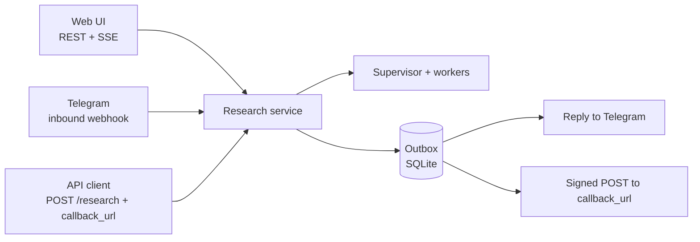
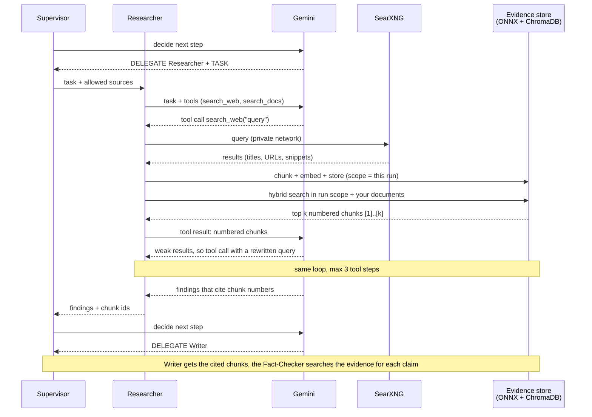

# Final Project — Brainstorm and Decisions

Summary of the brainstorm held on 2026-10-10, before any plan was written. It records **what** was decided and **why**, so the plans (`PLAN.md` and the detailed plans) can build on it without reopening each question.

The assignment is in [Final_Project_Options.md](Final_Project_Options.md).

## 1. Starting point

- The course has six modules. Each lab was built with the same standards: FastAPI with layered DDD, RFC 9457 errors, Next.js 16, tests with **0 real LLM calls**, and Railway + Vercel deploys.
- Earlier labs already cover large parts of each option:

| Option | Overlap with earlier labs |
|---|---|
| A — Code Review Bot | Almost the same as Module 2 (Code Analyzer) |
| B — Legacy Code Documenter | Mostly new work |
| C — Tech Debt Analyzer | Module 4 (RAG) + Module 2 (lizard metrics) |
| D — Multi-Agent Research Assistant | Almost the same as Module 5 (Supervisor, Researcher, Writer, Reviewer, Fact-Checker) |

- **The main constraint is the Gemini free tier:** `gemini-3.5-flash-lite` by default, and the quota belongs to the API key. Every design choice below is checked against it.

## 2. The choice: Option D, extended

**Decision:** Option D, with Module 5's lab as the base, extended with three new capabilities:

1. **Web search** as a tool the agent decides to use (SearXNG)
2. **RAG**: an evidence store per run, a document library with uploads, and semantic memory of past reports
3. **An integration pattern**: webhooks in both directions (Telegram and a signed `callback_url`)

**Why:** a plain Option D would repeat Module 5. The extensions are chosen to show **growth in agent design**, which is what an evaluator will look at:

| Lab | What the agent could do |
|---|---|
| Module 2 | One agent with tools |
| Module 3 | A fixed pipeline of agents |
| Module 4 | RAG: one retrieval per question, then an answer |
| Module 5 | A Supervisor that chooses the next worker each step |
| **Final project** | A Supervisor with **tool-using workers**, **agentic RAG** (the agent decides when, where and what to retrieve), and **outside triggers** (webhooks) |

**Gap to close:** the assignment's API is `POST /research` with a `depth` setting and a sectioned report (`title`, `summary`, `sections`, `references`). Module 5 uses `POST /run` with a single answer, so the API and report format must be reshaped.

## 3. Web search

**Decision:** **SearXNG**, self-hosted on Railway, called by the Researcher **as a tool**. Wikipedia (Module 5's API client) is the fallback.

| Option considered | Why not chosen |
|---|---|
| Gemini's built-in Google Search | Google runs the search internally, which **hides the agentic part** (the evaluator sees no design). It uses the Gemini quota, and the raw results can't be indexed |
| A search API (Tavily, Brave, Exa, Serper) | Another key, and free tiers change often. It stays as the **plan B** if SearXNG fails from Railway |
| `ddgs` library (DuckDuckGo) | Unofficial, rate-limited, breaks without warning |

**Why SearXNG:**
- **Costs nothing:** no key, and 0 Gemini quota.
- **Raw results:** they can be chunked into the evidence store.
- **Shows production skills:** a private service, several providers behind one interface, and a fallback chain.

**Rules that follow from it:**
- **Private network only.** No public domain, so SearXNG can't become an open proxy, and its rate limiter (and Valkey) isn't needed.
- **Snippets first.** Fetching a full page goes through guards:
  - refuse private IP addresses after the DNS lookup
  - limits on size and time
  - no redirects to private addresses
  - page text is data, never instructions
- **At most 3 tool calls per Researcher task.** Each tool step is one Gemini call. Three is enough to search, read, and retry once with a better query.
- **A proof of concept before building on it.** Search engines often block cloud-server IPs, so SearXNG is deployed first and tested from Railway ([POC_SEARXNG_RAILWAY.md](POC_SEARXNG_RAILWAY.md)).
  - **Outcome (2026-10-10): passed.** From Railway, Yahoo, Yandex and DuckDuckGo answered 10/10 queries with 89–97 % relevant results in about 0.6 s, using under 190 MB of RAM. Bing answered but returned off-topic pages, and the other engines were blocked. SearXNG is kept with those three engines.

## 4. RAG

**Decision:** all three uses.

| Use | What it does | Why |
|---|---|---|
| **Evidence store per run** | Search results are chunked, embedded and stored *during* the run, in a scope that belongs to that run | The Writer gets the relevant passages instead of whole pages (smaller prompts), and the Fact-Checker looks up evidence per claim. Chunk ids travel from Researcher to Writer to references |
| **Document library with upload** | `.md`, `.txt` and `.pdf` files; the Researcher can search them with a `search_docs` tool | The classic company research assistant: your documents plus the web |
| **Semantic memory of past reports** | Embeddings added on top of Module 5's BM25 memory | Finds past reports that are similar in meaning, not only in wording |

### Reused from Module 4

These pieces carry over almost unchanged:
- **Local embeddings:** ONNX `bge-small` through fastembed, behind an `Embedder` port. **0 Gemini calls.**
- **Caching:** the embedding cache (keyed by model + text hash) and the file-hash skip, so the same text is never embedded twice.
- **Storage:** ChromaDB on the Railway volume. Module 4's `codebase` filter becomes a **`scope`** filter: a run's evidence, a browser workspace, or the demo library.
- **Search:** hybrid vector + BM25, merged with Reciprocal Rank Fusion. BM25 gets a tokenizer mode for prose.
- **Chunkers:** the Markdown chunker (by heading path) and the fixed-size chunker with overlap.
- **Citations:** numbered context `[1]…[k]`, and the check that every cited `[n]` is a chunk that was sent.
- **Evaluation:** Precision@K, Recall@K and MRR (free and deterministic), plus the LLM judge and its sanity check with planted bad answers.
- **RAM:** the memory-tuning environment variables. Module 4 peaked at 393 MB with lean settings.

### Changed or dropped

- **Retrieval becomes a tool.** Module 4 retrieved once per question in a fixed pipeline. Here the agent decides whether to search, where to search, and with what query, and rewrites the query when results are weak. Module 4 rejected query expansion and HyDE because they cost a call every time. Here the rewriting happens only when the agent judges it necessary, within the tool cap.
- **Module 4's BM25 bug gets fixed.** BM25 statistics were computed over every indexed codebase, so one upload changed the scores of others. With private workspaces that would leak between users, so the statistics are computed **per scope**.
- **The reranker becomes optional.** It's off on Railway, where it added over 200 MB per request. It stays on for local evaluation.
- **The Python AST and tree-sitter chunkers are dropped.** The documents are prose, not code.

### New pieces

- **PDF text extraction** with page numbers, so citations read `report.pdf p.4`.
- **HTML → Markdown extraction** for pages the Researcher opens.
- **Source metadata on every chunk:** web, wiki or doc; URL or file name; title; retrieval date.
- **Duplicate removal** across sources.
- **Cleanup timers** for run evidence and expired workspaces.

### Who chunks uploaded files

- **A deterministic indexing service in the backend does it, not an agent.** The steps are validate → extract → chunk → embed → store, run as a background job (`202`, with an "indexing…" → "ready" status in the UI).
- **Why not an agent:**
  - Splitting a file has a correct, repeatable answer, so an LLM would add cost and randomness for nothing ("deterministic work first, LLM second", from Module 3).
  - Agents can only *read* the index, through `search_docs`. A planted prompt injection in an uploaded file therefore can't change how it is indexed or reach another workspace.
  - Chunkers are pure functions, unit-tested with 0 calls.
- **The same service also indexes web results.** The *tool's code* stores what `search_web` returns, without the LLM deciding anything. The agent only chooses what to search.

### Who can upload

**Decision:** a **private workspace per browser** that expires after 24 hours, plus a read-only **preloaded demo library**.

**Why:** the app has no login and a public URL. A fully open library could be filled up or seeded with prompt injections. An admin-only library would stop evaluators from trying their own files.

## 5. Integration pattern: webhooks, no message broker

**Decision:** webhooks in both directions, delivered reliably through a **transactional outbox** in SQLite. There is **no message broker** (no Redis, no RabbitMQ, no separate worker service).

| Direction | What |
|---|---|
| **Inbound** | A **Telegram bot**: a question sent in Telegram starts a research run. The bot replies with a link to follow the run live in the web UI, then sends the report summary and a link to the full report |
| **Outbound** | Replies to Telegram, and a **signed `callback_url`** on `POST /research` for API clients. Signed with HMAC following the Standard Webhooks spec, retried with growing delays, logged, and guarded against SSRF |

**Why webhooks over a broker:**
- **A broker's main benefit doesn't apply.** It lets several workers process jobs in parallel, but the Gemini quota is per key, so more workers would not complete more research.
- **It would cost two Railway services** (Redis plus a worker), and the free plan's slots are scarce.
- **The outbox gives the reliability.** The "send this webhook" row is written in the same transaction that marks the run finished, and a small background loop delivers it. Nothing is lost on failure or restart. It is a queue-like pattern without an external broker.

**Why Telegram:** free, the simplest setup (BotFather), a secret-token header on every request, and a strong live demo. Slack needs a workspace app and Discord needs Ed25519 signature checks.

**What the Telegram webhook must handle:**
- **Answer quickly:** reply `200` at once and queue the run through the outbox.
- **Skip duplicates:** Telegram resends a message if it doesn't get a `200`, so repeats are skipped using `update_id`.
- **Check every request:** the secret-token header is verified.
- **Protect the quota:** only allowed chat ids can start a run.
- **Fit the message limit:** Telegram allows 4,096 characters, so the chat gets a summary plus a link.

### Two ways in, one research service

Both entry points call the **same application service**. Only the adapters differ, so the agents never know where a request came from. Each run records its `channel` (`web`, `telegram` or `api`), and every run appears in the web history.



## 6. How one Researcher task works (agentic RAG)

The retrieval steps are the same as in Module 4: embed the query, vector search, BM25, RRF, optional rerank. What changes is **who calls them and when**: the Researcher, as a tool, as many times as it decides (up to 3).



**Gemini calls:** embeddings, ChromaDB, BM25 and SearXNG cost 0. Only the agent's decisions use Gemini, at one call per tool step.

## 7. Where things run

**Two services in one Railway project**, plus the frontend on Vercel.

| Service | Where | Contents |
|---|---|---|
| **backend** | Railway | One FastAPI process: API, agents, tools, indexing, retrieval, outbox. SQLite and ChromaDB on the `/data` volume |
| **searxng** | Railway, private network only | SearXNG, pinned image + our `settings.yml` |
| **frontend** | Vercel | Next.js, as in every module |

### Inside the backend

Indexing lives **in the same backend** as the agents, but in a separate part of it. The agents can only reach the index through the tools, and architecture tests enforce that.

```
backend (one FastAPI process)
├── api/              /research, /documents, /webhooks/telegram …
├── application/
│   ├── research/     Supervisor + Researcher, Writer, Reviewer, Fact-Checker
│   ├── tools/        search_web, search_docs  ← all the agents may call
│   ├── indexing/     extract → chunk → embed → store (uploads and web results)
│   ├── retrieval/    hybrid search
│   └── outbox/       webhook delivery loop
├── domain/           models + ports
└── infrastructure/   Gemini, SearXNG, ChromaDB, ONNX embedder, SQLite
```

**Why indexing isn't a separate service:**
- **One embedding model in memory.** Indexing and retrieval share the same loaded ONNX model; a second service would load it again within its own 1 GB.
- **One database.** SQLite stays in one place on one volume.
- **It can still be split later.** Indexing sits behind a port, so a split would only need an HTTP adapter.

**What to watch:** indexing and research runs share 1 GB of RAM. Indexing runs one job at a time with small embedding batches, and memory is measured with `railway metrics` after the deploy.

**Railway clean-up:** the free plan allows 2 projects. Both earlier ones (Modules 4 and 5) were deleted on 2026-10-10 for the SearXNG proof of concept, and the new project is **`Research-Assistant-Final-Project`**.

## 8. Plans to write

In this order. Agent behavior and tool use get their own plans, because that is where the evaluator will look.

| # | Plan | Content |
|---|---|---|
| 1 | `POC_SEARXNG_RAILWAY.md` | Infrastructure spike: deploy SearXNG, test the engines from Railway's IPs, record the results |
| 2 | `PLAN.md` | Big picture, decisions, diagrams |
| 3 | `BACKEND_PLAN.md` | Layers, API, data, budgets, tests |
| 4 | Agent plans | Supervisor, Researcher, Writer, Reviewer |
| 5 | Tool plans | SearXNG tool (how the agent uses search), document chunking / RAG |
| 6 | Webhook plan | Telegram in and out, `callback_url`, outbox |
| 7 | `FRONTEND_PLAN.md` | Last |

**Still open:**
- **Folder layout:** a `plans/` subfolder (`agents/`, `tools/`, `integrations/`) or everything at the `Final_project/` level.
- **The webhook plan:** under the agents group (as first listed) or its own integrations group (proposed, since it isn't an agent).
- **The chunking plan:** about uploads only, or widened into a full RAG plan (proposed, since web results go through the same pipeline).
- **The Fact-Checker** (a fourth worker from Module 5 that Option D doesn't list): keep it, inside the Reviewer plan (proposed).

## 9. Other settled points

- **Rubric:** no rubric file, so the plans follow the Option D evaluation checklist.
- **GitHub:** a public repo `RodrigoDamasio/TA_FinalProject`, publishing only `README.md`, `.gitignore` and `Final_project/`, like the modules.
- **Secrets:** the user sets the Gemini key and the Telegram bot token on Railway themselves. Neither is ever printed.
