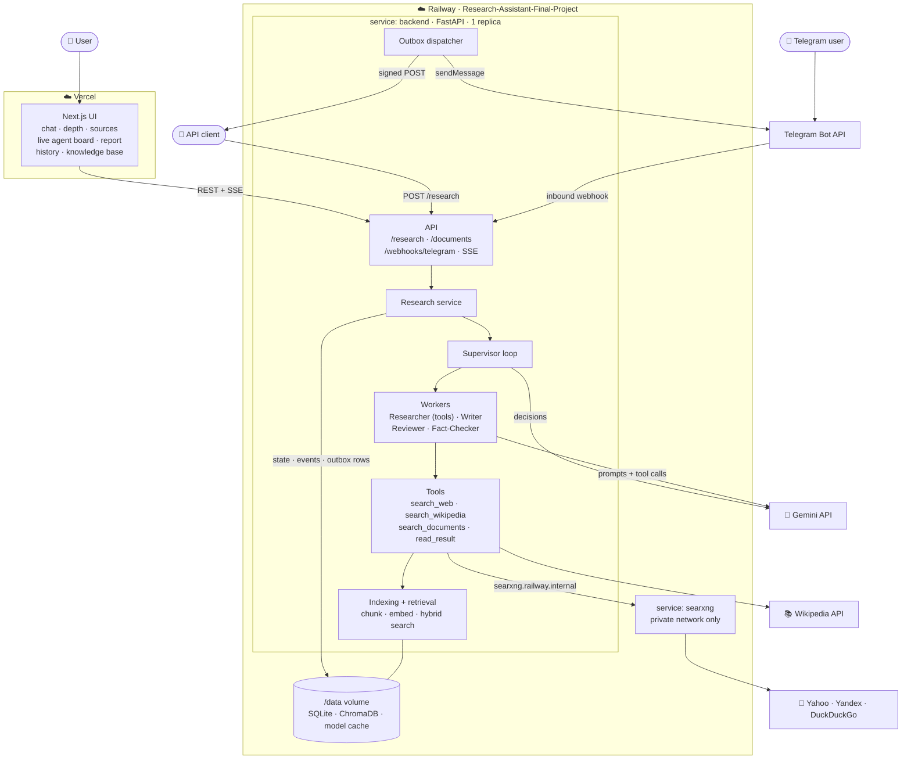
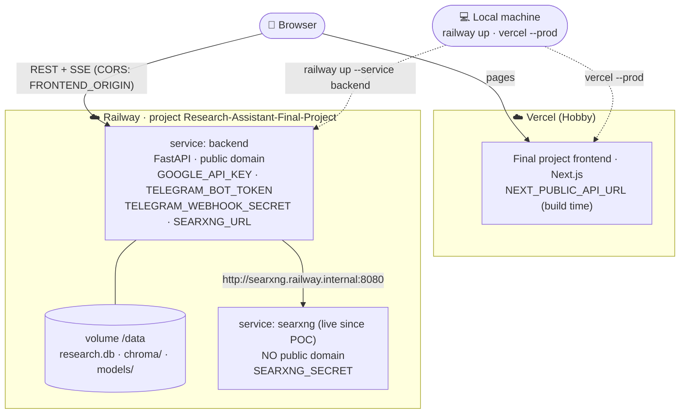
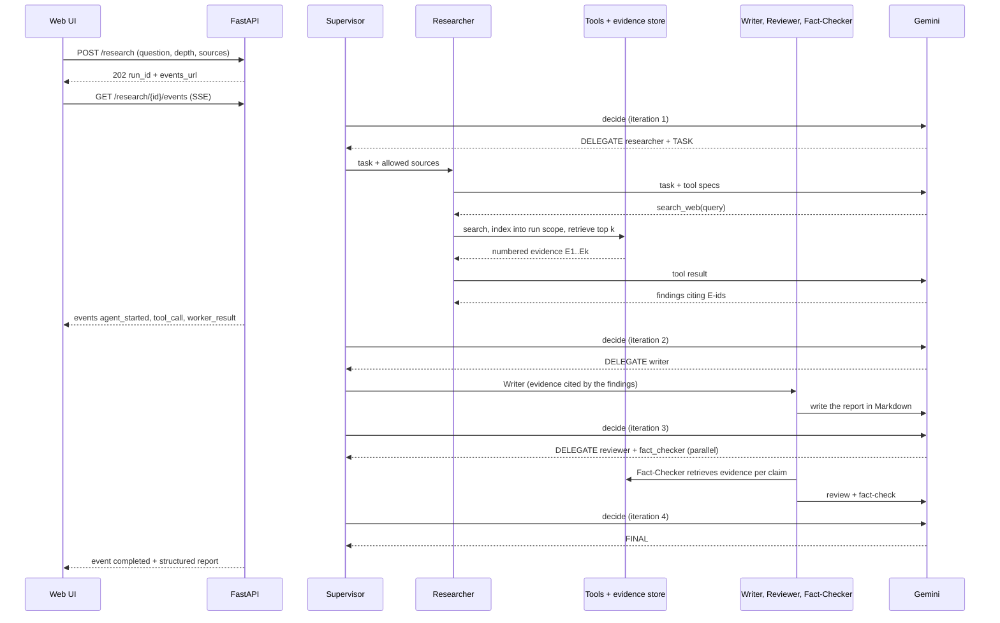
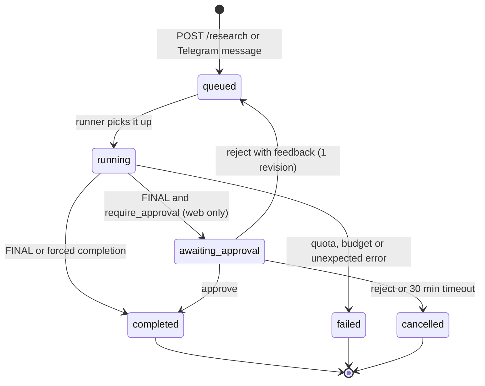
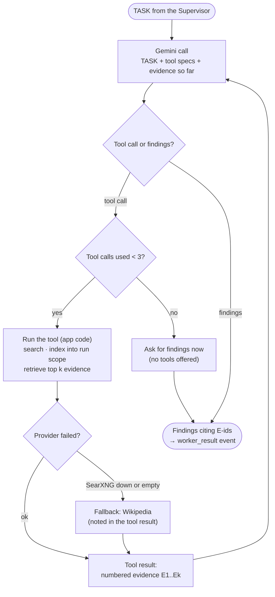
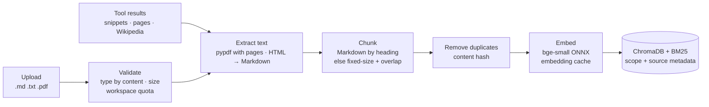
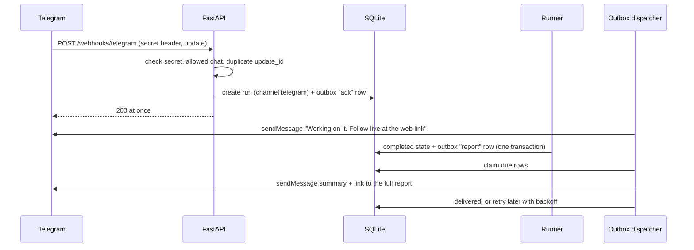

# Final Project — Big Picture Plan: Multi-Agent Research Assistant

Solution-level plan for **Option D** of [Final_Project_Options.md](Final_Project_Options.md), extended as decided in [BRAINSTORM.md](BRAINSTORM.md). The search service was validated first in [POC_SEARXNG_RAILWAY.md](POC_SEARXNG_RAILWAY.md).

Detailed designs follow in `BACKEND_PLAN.md` (shared contracts), then one plan per agent, tool and integration (§15), then `FRONTEND_PLAN.md`.

## 1. What we are building

A web app, and a Telegram bot, where a user asks a research question and a team of agents produces a **sectioned, cited report**:

1. The **Supervisor** breaks the question into steps and, one step at a time, delegates to a worker or finishes.
2. The **Researcher** is a **tool-using agent**. It decides *where* to look (the web through SearXNG, Wikipedia, the user's uploaded documents), *what* to search for, and whether to search again with a better query. Everything it finds is indexed into a per-run **evidence store**.
3. The **Writer** turns the evidence into a structured report that cites the evidence.
4. The **Reviewer** checks quality and balance. The **Fact-Checker** checks each claim against the evidence store.
5. The Supervisor **synthesizes** the final report. If it hits the iteration limit, the app **forces** completion with what it has.

**Three ways in, one engine:**

| Channel | How |
|---|---|
| **Web** | Chat-like UI with live agent progress (SSE), depth selector, conversation history, knowledge-base page |
| **API** | `POST /research`, optionally with a signed **`callback_url`** that receives the report when the run ends |
| **Telegram** | Send a question to the bot. It replies with a live link, then the report summary |

### What is new compared with Module 5

| | Module 5 (base) | Final project |
|---|---|---|
| **Researcher** | The app fetches Wikipedia, then **1** summarizing call | A **tool loop**: up to 3 tool calls (search the web, Wikipedia or documents, read a result), then findings |
| **Sources** | Wikipedia | Web (SearXNG: Yahoo, Yandex, DuckDuckGo) + Wikipedia + uploaded documents |
| **Evidence** | Source extracts passed as text | **Evidence store per run**: chunked, embedded, hybrid search. Citations point to evidence chunks |
| **Fact-Checker** | Reads the whole extracts | **Retrieves** evidence per claim |
| **Memory** | BM25 over past tasks | Hybrid (BM25 + embeddings) over past **reports** |
| **Output** | A Markdown answer | A **structured report**: `title`, `summary`, `sections[]`, `references[]`, plus `metadata` and `conversation_history` |
| **API** | `POST /run` | `POST /research` with `depth` (brief, detailed, technical) and `sources`, plus document endpoints and webhooks |
| **Integration** | Async runs + SSE | + **inbound webhook** (Telegram), **outbound webhooks** (Telegram replies, signed `callback_url`), **transactional outbox** |

### The learning journey this shows

| Lab | What the agents could do |
|---|---|
| Module 2 | One agent with tools (code metrics) |
| Module 3 | A fixed pipeline of agents with human approval |
| Module 4 | RAG: one retrieval per question, then an answer |
| Module 5 | A Supervisor that chooses the next worker each step |
| **Final** | A Supervisor with **tool-using workers**, **agentic RAG** (the agent decides when, where and what to retrieve), and **outside triggers** (webhooks) |

## 2. Key decisions

All of them are settled in [BRAINSTORM.md](BRAINSTORM.md). Summary:

| Decision | Choice |
|---|---|
| Base | **Module 5 lab**, copied and extended. Module 4 for the RAG pieces |
| Stack | Python 3.12 · FastAPI · SQLite. Next.js 16 · TypeScript · Tailwind v4 · Zod |
| LLM | Gemini free tier, `gemini-3.5-flash-lite`, through the Module 5 adapter and decorators (tool calling already supported) |
| Agent pattern | **Supervisor** with the `DELEGATE` / `TASK` / `FINAL` text protocol and a strict parser (Module 5). Workers: Researcher, Writer, Reviewer, Fact-Checker |
| Web search | **SearXNG**, self-hosted on Railway, private network only, engines `yahoo`, `yandex`, `duckduckgo` (POC) |
| Researcher | **Tool-calling loop**, max **3** tool calls per task. Wikipedia is both a tool and the fallback when SearXNG fails |
| RAG | Evidence store per run, document library with upload, semantic memory. Module 4 stack: fastembed `bge-small` ONNX, ChromaDB, hybrid BM25 + vector + RRF. BM25 statistics **per scope**. Reranker optional (off on Railway) |
| Indexing | A **deterministic service**, not an agent. Agents only *read* the index through tools |
| Uploads | A **private workspace per browser** (24 h) + a read-only **demo library** |
| Integration | **Webhooks** in and out (Telegram bot, signed `callback_url`), delivered through a **transactional outbox** in SQLite. No message broker |
| Hosting | Railway project **`Research-Assistant-Final-Project`**: `backend` + `searxng` (live). Frontend on **Vercel** |
| Work split | Contracts written locally. Detailed plans and implementation fan out to **cloud sessions** in parallel (fakes only). Real Gemini calls, deploys and secrets stay local |

## 3. Architecture



### Deployment view



| Service | Where | Notes |
|---|---|---|
| `backend` | Railway, public domain | `railpack.json` (uvicorn `--proxy-headers`), health check `/health`, volume `/data`, 1 replica. Secrets set **by the user** |
| `searxng` | Railway, private only | Pinned image + `settings.yml` from the POC. ~140–190 MB RAM |
| frontend | Vercel | `NEXT_PUBLIC_API_URL` inlined at build time |

**Why one backend service, not one per agent or component:**
- **One process owns the quota.** The Gemini quota belongs to one key, and a single process holds the rate gate and the circuit breaker.
- **One embedding model in memory,** shared by indexing and retrieval.
- **One SQLite database:** runs, events, outbox, documents and caches commit in one transaction.
- **It fits the free plan's service limits.**

Any component can move out later behind its port with an HTTP adapter.

### One research run, end to end



### Run states

Unchanged from Module 5, apart from the outbox rows written at the end.



**The outbox row is written in the same transaction as the final state.** Reaching `completed`, `failed` or `cancelled` also writes one outbox row per subscriber (the run's `callback_url`, the Telegram chat).

## 4. Agents

Each agent is a versioned prompt (`app/prompts/` + `VERSION`), an input contract and an output contract, registered in the **worker registry** (Module 5). Detailed prompts and rules go into the per-agent plans (§15).

| Agent | Input | Output | LLM calls |
|---|---|---|---|
| **Supervisor** | Question, depth, allowed sources, worker list, relevant past reports (memory), transcript so far, iterations and budget left | Protocol text: `DELEGATE` + `TASK` (up to 2 in parallel) or `FINAL` | 1 per iteration (+1 repair at most) |
| **Researcher** | Its TASK, allowed sources, tool specs | Findings in Markdown citing evidence ids `[E3]`, plus the list of evidence used | 1 per tool step, **≤ 4** (3 tool calls + findings) |
| **Writer** | TASK, findings, the cited evidence chunks, depth | The report in Markdown: `# Title`, a summary paragraph, `##` sections, `[E…]` citations | 1 |
| **Reviewer** | Draft, findings | Strict JSON `{verdict: approve or revise, issues[], balance_flags[]}` | 1 |
| **Fact-Checker** | Draft. It **retrieves** evidence for each claim from the run scope (deterministic, 0 calls) | JSON `{claims: [{text, status: supported, unsupported or contradicted, evidence_ids}]}` | 1 |

**Context is built by the app, not the model** (Module 5): the question, plus the latest result of each other worker, trimmed to a token budget. The Supervisor only writes the TASK line.

**From Markdown to the structured report:** a **deterministic parser** turns the final Markdown into `{title, summary, sections[{heading, content}], references[]}`. References are built from the cited evidence ids (URL or document name, title, page). It costs 0 calls and is unit-tested.

## 5. The Researcher: a tool-using agent

This is the part the evaluator will look at most.



### The tools

| Tool | What the app does | Returns to the model |
|---|---|---|
| `search_web(query)` | SearXNG (private) → top results → snippets chunked + indexed into the **run scope** → hybrid retrieval for `query` | Numbered evidence: id, title, domain, snippet |
| `search_wikipedia(query)` | Module 5 Wikipedia client (cached) → extracts chunked + indexed → retrieval | Same shape |
| `search_documents(query)` | Hybrid retrieval in the **workspace** + **demo library** scopes (read-only) | Same shape, with document name and page |
| `read_result(evidence_id)` | Fetches the **full page** behind a web result the model already saw, through the SSRF guard. Converted HTML → Markdown, chunked + indexed, then the most relevant chunks are retrieved | The page's best-matching chunks |

**Rules that make this safe and cheap:**
- **No arbitrary URLs.** `read_result` takes an **evidence id**, not a URL, so the model can only open pages a search returned.
- **Allowed sources are enforced by the app.** The `sources` field of the request (web, wikipedia, documents) decides which tools the model is *offered* at all.
- **The cap is code, not prompt:** max **3 tool calls** per Researcher task. After that, the model is called with no tools and must give findings.
- **Everything a tool returns is data.** It's wrapped in nonce-tagged blocks (Module 5), so a page saying "ignore previous instructions" is just text.
- **Every tool call is visible:** recorded in the transcript and streamed as a `tool_call` event (tool, query, result count, provider, fallback used, time), so the UI and the evaluation show *how* the agent searched.

## 6. RAG

Details go in `RAG_PLAN.md`. The big picture:

| Scope | Filled by | Read by | Lifetime |
|---|---|---|---|
| `run:{id}` (evidence) | The tools, during the run | Researcher (retrieval), Writer (cited chunks), Fact-Checker | Deleted with the run (30-day retention) |
| `workspace:{id}` (uploads) | `POST /documents` → indexing job | `search_documents` | 24 h after creation |
| `demo` (library) | Seeded at startup from `backend/samples/library/` | `search_documents` | Permanent, read-only |
| `memory` (past reports) | Each completed run | The Supervisor (top 3 relevant past reports) | 30 days |

### Indexing pipeline (deterministic, 0 LLM calls)



- **Uploads run as a background job** (`202`, status `indexing` → `ready` / `failed`), **one job at a time**, with small embedding batches (Module 4 memory tuning).
- **Retrieval:** vector + BM25, merged with RRF. BM25 statistics are computed **per scope**, which fixes the Module 4 cross-codebase bug. The optional cross-encoder reranker is off on Railway.
- **Metadata on every chunk:** `scope`, `source_type` (web, wiki or doc), `url` or `document`, `title`, `page`, `retrieved_at`, `content_hash`.

## 7. Webhooks and the outbox

Details go in `WEBHOOKS_PLAN.md`.



| Piece | Design |
|---|---|
| **Inbound Telegram** | `POST /webhooks/telegram`. Every request checks `X-Telegram-Bot-Api-Secret-Token`. **Allowed chat ids** only (quota protection). Duplicate `update_id`s are ignored. Commands: `/start`, `/help`, plain text = a question (depth `brief` by default) |
| **Outbound `callback_url`** | Optional on `POST /research`. Signed per the **Standard Webhooks** spec (`webhook-id`, `webhook-timestamp`, `webhook-signature` = HMAC-SHA256), with a **per-run secret returned once** in the `202` response. SSRF guard on the URL (public HTTPS hosts only) |
| **Outbox** | A SQLite table written in the **same transaction** as the run state. A dispatcher thread claims due rows, delivers them, and retries with growing delays (e.g. 10 s, 1 min, 5 min, 30 min, 2 h), then marks them **dead**. **At-least-once** delivery; the `webhook-id` lets receivers drop duplicates |
| **Visibility** | `GET /research/{id}/deliveries` lists attempts (status, HTTP code, time, never payload secrets). The UI shows them on the run |

## 8. API contract (summary)

`BACKEND_PLAN.md` holds the exact schemas.

| Method · Path | Purpose |
|---|---|
| `POST /research` | Body `{question, depth?, max_iterations?, sources?, require_approval?, callback_url?}`. Headers: `X-Workspace-Id` (optional). Returns `202 {run_id, status_url, events_url, callback_secret?}`. With `?wait=true`: `200` with the assignment's response shape: `{report, metadata, conversation_history}` |
| `GET /research/{id}` | The same shape plus `status`, `forced`, `flags`, `tool_calls[]` and `meta` (calls, tokens, time per agent, estimated cost) |
| `GET /research/{id}/events` | SSE: `run_started`, `agent_started`, `decision`, `tool_call`, `worker_result`, `awaiting_approval`, `completed`, `failed` (`Last-Event-ID` resume) |
| `POST /research/{id}/approve` · `/reject` | Human-in-the-loop (Module 5) |
| `GET /research/{id}/deliveries` | Webhook delivery attempts |
| `POST /documents` · `GET /documents` · `GET /documents/{id}` · `DELETE /documents/{id}` | Workspace library (header `X-Workspace-Id`), multipart upload, status, delete |
| `POST /webhooks/telegram` | Telegram inbound webhook |
| `GET /agents` · `GET /samples` · `GET /health` · `GET /problems/{slug}` | Registry, stored replayable runs, service level + limits, RFC 9457 pages |

**Request fields:**
- **`depth`:** `brief` (≈ 300 words, 2–3 sections), `detailed` (default, ≈ 800 words, 4–6 sections), `technical` (precise terms, examples, official sources preferred, 5–7 sections).
- **`sources`:** any of `web`, `wikipedia`, `documents` (default: all available).
- **`max_iterations`:** 1–8, default 5.

**Errors:** RFC 9457, Module 5's list plus `unsupported-media-type`, `document-not-found`, `workspace-quota-exceeded`, `invalid-callback-url` and `webhook-unauthorized`.

## 9. Assignment checklist → design

| Option D requirement | Where |
|---|---|
| Three specialized workers (Researcher, Writer, Reviewer) | §4. Plus the Fact-Checker |
| Supervisor: decompose, delegate, coordinate, synthesize | §4, Module 5 loop + protocol |
| Delegates with `DELEGATE` / `TASK` | Module 5 parser |
| Builds context from previous results | §4 context builder |
| `POST /research`, iterative loop, structured JSON | §8, §3 |
| Parses Markdown into a structured report | §4 report parser |
| Conversation history captured | `conversation_history` (decisions, tool calls, results) |
| Configurable `max_iterations`, depth | §8 |
| Error handling, timeouts, progress tracking | Module 5 guards, budgets, forced completion, SSE |
| Frontend: chat, depth selector, live agent progress, sectioned report, history sidebar | `FRONTEND_PLAN.md` |
| **Bonus:** streaming · web search tool · citations · multiple formats · agent metrics | SSE · §5 · evidence references · depth · per-agent calls, tokens and time |
| Deployed and accessible | §3 deployment |

## 10. Production patterns, carried over

From Module 5, unchanged unless noted:
- **Rate limits:** per IP on new runs and uploads, **per chat** on Telegram.
- **Caching:** the response cache, the Wikipedia cache, the embedding cache, **plus a SearXNG result cache** (short TTL).
- **Retries and circuit breaker** on Gemini.
- **Service levels:** full → reduced (SearXNG or Wikipedia down) → minimal (daily quota: samples and cached runs only) → offline.
- **Prompt-injection defenses:** input flagging, nonce-tagged data blocks, canary, output redaction.
- **Cost meter:** calls, tokens and estimated paid cost per run, **per agent**.
- **30-day retention.**

## 11. Free-tier strategy

| Activity | Real Gemini calls |
|---|---|
| Every test suite (local and cloud sessions) | **0**: fake LLM, cassettes, fake search, fake embedder |
| A typical run (detailed) | **~10–12** (≈4 Supervisor, 2–4 Researcher, Writer, Reviewer, Fact-Checker) |
| Hard cap per run | A per-run budget (formula in `BACKEND_PLAN.md`) → forced completion, never a loop |
| Identical rerun | **0** from the cache (tool results cached too) |
| Indexing, retrieval, search | **0** (local ONNX, SearXNG, Wikipedia) |
| Evaluation | Opt-in, cached, resumable, `--max-calls`, **run locally by the user** |
| Demo | **0**: stored sample runs replay in the UI. Telegram runs are real calls, so they are limited to the allowed chats |

## 12. Evaluation

Agent behavior, not only the answer:

| Area | Metric | Calls |
|---|---|---|
| **Retrieval** | Precision@K, Recall@K, MRR on the demo library (a dataset of questions with known relevant chunks) | 0 |
| **Tool use** | Tool calls per task, query rewrites after weak results, sources used, fallback rate, cap hits | 0 (from the transcript) |
| **Grounding** | Citation validity (every `[E…]` exists), Fact-Checker supported ratio | 0 |
| **Run checks** | Completed without forcing, all workers ran, protocol valid first try, budget respected, injection sample not followed, no canary or secret in the output | 0 |
| **Report quality** | LLM judge (faithfulness, relevance, coverage) + the **judge sanity check** with planted bad reports | 1 per example, cached |

## 13. Security

- **Untrusted text is data:** questions, web pages, snippets, uploaded documents and worker outputs all go into nonce-tagged blocks. The canary and output validators stay.
- **SSRF guard** on every outbound fetch the backend makes from external input: `read_result` pages and `callback_url`. It resolves the host and refuses private, loopback and link-local addresses, re-checks after redirects, and caps size and time.
- **Agents cannot write:** the tools only search and read. Only the deterministic indexing service writes to the index.
- **Workspace isolation:** the workspace id is a random 128-bit value created by the browser and used as a capability. All document queries filter by it. Expired workspaces are purged.
- **Webhooks:** Telegram secret header + chat allowlist + `update_id` duplicate check. Outbound deliveries are signed, and secrets never appear in logs or the deliveries list.
- **Secrets are set by the user on Railway:** `GOOGLE_API_KEY`, `TELEGRAM_BOT_TOKEN`, `TELEGRAM_WEBHOOK_SECRET`. They are never printed, and never placed in a cloud-session environment.
- **Carry-over:** RFC 9457, CORS order, Ruff `S`, bound SQL, logs with ids, sizes and counters only, privacy notice (questions go to Gemini, queries to search engines and Wikipedia).

## 14. Target structure

```
Final_project/
├── Final_Project_Options.md  BRAINSTORM.md  POC_SEARXNG_RAILWAY.md
├── PLAN.md                ← this file
├── BACKEND_PLAN.md        ← next: shared contracts
├── plans/                 detailed plans (§15)
├── FRONTEND_PLAN.md
├── poc_searxng/           → Railway service searxng (Dockerfile + settings.yml)
├── backend/               → Railway service backend
│   ├── app/
│   │   ├── domain/          run, report, evidence, document, outbox, ports
│   │   ├── application/     research service, supervisor, workers/, tools/,
│   │   │                    indexing/, retrieval/, outbox/, report parser, guards
│   │   ├── prompts/         supervisor + one per worker, VERSION
│   │   ├── infrastructure/  gemini, searxng, wikipedia, chroma, embedder, sqlite, telegram, http (SSRF guard)
│   │   └── api/             routes, SSE, webhooks, problems, wiring
│   ├── samples/  (runs/, library/)   eval/   tests/
│   └── DEPLOY.md
└── frontend/              → Vercel
```

## 15. Plans to write

Each detailed plan is one **cloud-session task**, run once `BACKEND_PLAN.md` has fixed the shared contracts.

| # | Plan | Content | Where |
|---|---|---|---|
| 1 | `BACKEND_PLAN.md` | Layers, ports, domain and API schemas, config, budgets, data model, test strategy, implementation steps | **Local, with the user** |
| 2 | `plans/agents/SUPERVISOR_PLAN.md` | Prompt, protocol changes (sources, depth), context, memory, forced completion | Cloud |
| 3 | `plans/agents/RESEARCHER_PLAN.md` | Tool loop, tool specs, prompts, cap, fallback, query rewriting, events | Cloud |
| 4 | `plans/agents/WRITER_PLAN.md` | Report Markdown format per depth, citations, the report parser | Cloud |
| 5 | `plans/agents/REVIEWER_PLAN.md` | Reviewer checklist + **Fact-Checker** retrieval per claim | Cloud |
| 6 | `plans/tools/SEARXNG_TOOL_PLAN.md` | SearXNG adapter, result cache, `read_result` + HTML extraction + SSRF guard, Wikipedia fallback | Cloud |
| 7 | `plans/tools/RAG_PLAN.md` | Scopes, chunkers, PDF extraction, embedding, hybrid retrieval per scope, documents API, workspaces, memory, retrieval evaluation | Cloud |
| 8 | `plans/integrations/WEBHOOKS_PLAN.md` | Telegram in and out, `callback_url` signing, outbox, dispatcher, deliveries | Cloud |
| 9 | `FRONTEND_PLAN.md` | UI | Local or cloud |

## 16. Phases

| # | Phase | Real calls | Where |
|---|---|---|---|
| 0 | **Foundation:** copy the Module 5 backend and the Module 4 RAG pieces into `backend/`. Rename `/run` → `/research`. Green tests | 0 | Local |
| 1 | `BACKEND_PLAN.md` contracts as code: ports, domain types, API schemas, report parser, fakes | 0 | Local |
| 2 | Tools + Researcher loop (fake LLM, fake search) | 0 | Cloud |
| 3 | RAG: indexing, scopes, documents API, memory | 0 | Cloud |
| 4 | Writer report format, Reviewer + Fact-Checker on evidence | 0 | Cloud |
| 5 | Webhooks: Telegram, `callback_url`, outbox | 0 | Cloud |
| 6 | **Integration** of the branches, end to end in `LLM_MODE=fake` | 0 | Local |
| 7 | **Real Gemini:** cassettes, first real runs, prompt fixes, evaluation, sample runs | ~3 + ~40 | Local (user) |
| 8 | Frontend | 0 | Cloud + local E2E |
| 9 | Deploy backend + Vercel, Telegram webhook registration, post-deploy checks, production E2E | 0–12 | Local |

Phases 2–5 run **in parallel** in cloud sessions, each on its own branch with its own folders.

## 17. External tasks (you)

- **Telegram bot:** create it with BotFather. Set `TELEGRAM_BOT_TOKEN` and a random `TELEGRAM_WEBHOOK_SECRET` on Railway (you run the command), and list your chat id in `TELEGRAM_ALLOWED_CHATS`.
- **Gemini key:** set `GOOGLE_API_KEY` on the backend at deploy time, as in every module.
- **Real-model runs:** run the evaluation and the first real runs locally (phase 7).
- **Cloud sessions:** review and merge the cloud-session PRs.

## 18. Decisions (you)

All decided on 2026-10-10:

1. **Plans folder:** `plans/agents`, `plans/tools`, `plans/integrations`.
2. **Fact-Checker:** kept, planned inside `REVIEWER_PLAN.md`.
3. **Demo library:** 5–8 permissively licensed Markdown/PDF documents on AI engineering topics (RAG, agents, webhooks…), plus one with a planted prompt injection for the evaluation. The list and licenses go in `RAG_PLAN.md`.
4. **Human approval:** Module 5's optional approval step is kept, **web only**. Telegram and API runs never pause.

## 19. Risks

| Risk | Mitigation |
|---|---|
| Search engines block the new egress IP after a redeploy | Three engines, a short result cache, Wikipedia fallback, `unresponsive_engines` logged. The engine list is configuration |
| flash-lite misuses tools (loops, junk queries, ignores results) | Cap of 3 in code, then a no-tools call. Repeated identical queries are answered from the cache. Tool-use metrics in the evaluation |
| More calls per run than Module 5 | Per-run budget, cache, `brief` depth for Telegram, minimal service level on the daily quota |
| RAM: ONNX + ChromaDB + agents in 1 GB | Module 4 lean settings, reranker off, one indexing job at a time, measured with `railway metrics` |
| Prompt injection in pages or uploads | Nonce-tagged data, tools that only read, canary, an injection document in the demo library and the evaluation |
| Parallel cloud sessions conflict | Contracts fixed first. Each task owns its folders. Shared files change only when the task says so |
| Webhook abuse (spoofed Telegram calls, SSRF via `callback_url`) | Secret header, chat allowlist, SSRF guard, rate limits |
