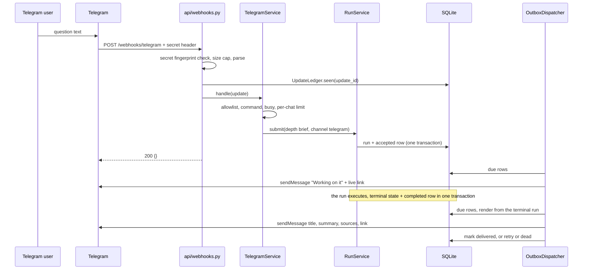
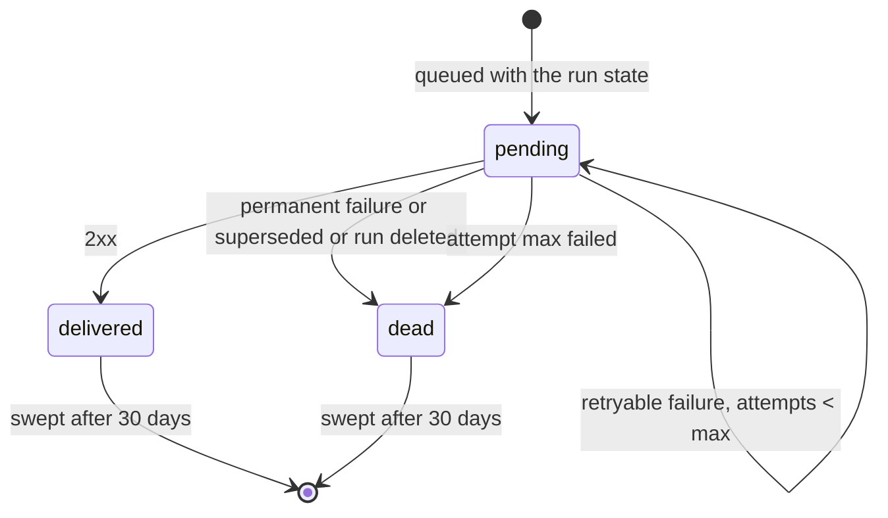
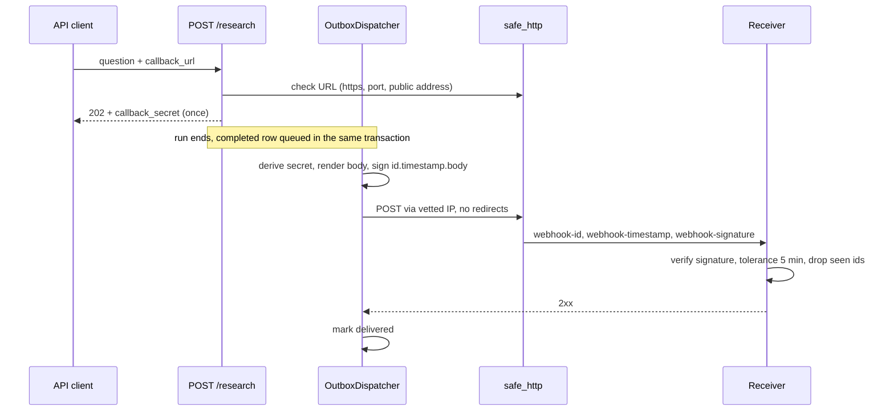

# Webhooks — Detailed Plan

Telegram in and out, the signed `callback_url`, and the outbox dispatcher. Builds on the 🔒 contracts in [`../../BACKEND_PLAN.md`](../../BACKEND_PLAN.md) (§5.6, §6, §8, §13, §14, §16). Decisions come from [`BRAINSTORM.md` §5](../../BRAINSTORM.md#5-integration-pattern-webhooks-no-message-broker) and [`PLAN.md` §7](../../PLAN.md#7-webhooks-and-the-outbox).

## 1. Scope and owned files

Rows of BACKEND_PLAN §4 owned by WEBHOOKS:

| File | Content |
|---|---|
| `application/outbox/` | `dispatcher.py` (`OutboxDispatcher`), `payloads.py` (callback bodies + Telegram texts), `signing.py` (Standard Webhooks), `schedule.py` (retry delays), `deliveries.py` (`DeliveryView` mapping), `callback_url.py` (syntax rules) |
| `application/telegram.py` | `TelegramService`: update → command / `RunService.submit` / reply |
| `infrastructure/telegram_client.py` · `fake_telegram.py` | `TelegramGateway` adapters |
| `infrastructure/webhook_sender.py` | `HttpWebhookSender` (`WebhookSender`, through `safe_http`) |
| `infrastructure/outbox_store.py` | `SqliteOutboxStore` (`OutboxRepository`) and `SqliteUpdateLedger` (`UpdateLedger`) |
| `api/webhooks.py` | `POST /webhooks/telegram` |
| `tests/…/test_webhooks_*.py`, `test_outbox_*.py`, `test_telegram_*.py` | This area's tests |

**In:** inbound Telegram updates, bot replies, the `setWebhook` procedure, callback signing and validation rules, the dispatcher (retries, `dead`, sweeper, recovery), the deliveries view mapping, the receiver example, the demo.

**Out:** the outbox DDL and the transaction that writes rows (`sqlite_store.py`, Shared), `RunService.submit` and the `_notify` hook (Shared), `safe_http.py` (SEARXNG), the route `GET /research/{id}/deliveries` (Shared `routes.py`; it calls `deliveries.py`), the frontend.

## 2. Reuse

Module 5 has no webhook code. What carries over:

| From | Use | How |
|---|---|---|
| M5 `api/guards.py` `RateLimiter` | Per-chat limit (`tg:<chat>` key) | **As-is**, a second instance with the Telegram limits |
| M5 `infrastructure/runner.py` `ThreadRunner._sweeper` | Pattern for the dispatcher thread (daemon, `threading.Event` stop, never dies on an exception) | **Adapted** into `OutboxDispatcher.start/stop` |
| M5 `application/runs.py` `recover()` / `sweep()` | Restart recovery turns stuck runs into `failed`, which now queues `research.failed` rows; sweep pattern for retention | **As-is** (Shared); WEBHOOKS adds `OutboxDispatcher.sweep()` |
| M5 `infrastructure/sqlite_store.py` `_Store`, `SqliteSettings.prompt_secret` | Store base class (lock + bound SQL); the persisted server secret used to derive callback secrets (§3.5) | **As-is** |
| M5 `infrastructure/wikipedia.py` | `httpx.Client` injection for tests (`httpx.MockTransport`) | Pattern |
| M5 `application/security.py` `_hmac` | HMAC helper style | Pattern |
| M5 `api/problems.py` | `webhook-unauthorized` problem type | Extended (Shared, slug already in §14.6) |

## 3. Design

### 3.1 Telegram inbound (`api/webhooks.py`)

The route stays thin: authenticate, parse, de-duplicate, hand over, answer `200 {}`.

| Step | Rule |
|---|---|
| 1. Mode | `TELEGRAM_MODE=off` → `404` (problem `about:blank`), so the route doesn't exist for scanners |
| 2. Auth | `X-Telegram-Bot-Api-Secret-Token` compared by **SHA-256 fingerprint**: `hmac.compare_digest(sha256(header), sha256(TELEGRAM_WEBHOOK_SECRET))`. Missing, wrong, or no secret configured → `401 webhook-unauthorized`. Nothing about the header is logged |
| 3. Size | Body read capped at **256 KB**. Larger → log `oversized` and answer `200` (a `413` would make Telegram retry forever) |
| 4. Parse | Lenient Pydantic models (`extra="ignore"`): `update_id: int`, `message: {message_id, chat: {id, type}, text?}`. Invalid JSON or no `update_id` → `200`, logged as `unparseable` |
| 5. Duplicate | `UpdateLedger.seen(update_id)` (atomic `INSERT OR IGNORE`). Already seen → `200`, logged `duplicate` |
| 6. Handle | `TelegramService.handle(update)`: synchronous, no LLM, a few SQLite writes (< 50 ms). It **never raises** to the route |
| 7. Answer | `200 {}` |

Updates other than `message` (edited messages, channel posts, callbacks) are ignored: `setWebhook` asks only for `message` (§3.3), and the parser drops the rest.

### 3.2 `TelegramService` (`application/telegram.py`)

```python
class TelegramService:
    def __init__(self, runs: RunService, outbox: OutboxRepository, limiter: RateLimiter,
                 allowed_chats: frozenset[str], texts: TelegramTexts, clock: Clock) -> None: ...
    def handle(self, update: TelegramUpdate) -> None: ...
```

Decision order for one `message` (first match wins):

| # | Condition | Action | Reply (`bot.reply`, §3.6) |
|---|---|---|---|
| 1 | Chat not in `TELEGRAM_ALLOWED_CHATS` | No run. At most **one reply per chat per hour** (in-memory) | `NOT_ALLOWED` |
| 2 | No `text` (photo, sticker, voice…) | — | `TEXT_ONLY` |
| 3 | `/start` (also `/start@<bot>`) | — | `START` |
| 4 | `/help`, or any other `/command` | — | `HELP` |
| 5 | The chat has a run in `queued` or `running` (`RunRepository.runs_in`, telegram subscriber = chat) | — | `BUSY` |
| 6 | Per-chat limiter: `RateLimiter(per_minute=2, per_day=TELEGRAM_RUNS_PER_DAY)`, key `tg:<chat>` | `RateLimited` | `RATE_LIMITED` |
| 7 | Otherwise | `RunService.submit(SubmitCommand(question=text, depth=brief, sources=all available, max_iterations=None, require_approval=False, use_memory=True, workspace_id=None, channel=telegram, callback_url=None, telegram_chat_id=chat, client_key="tg:<chat>"))` | none here: `submit` queues `research.accepted` |

Errors raised by `submit` become replies: `InvalidField` (too short) → `TOO_SHORT`, `InputTooLarge` → `TOO_LONG`, `QueueFull` → `BUSY_SERVER`, `LLMQuotaExceeded` → `QUOTA`, `LLMUnavailable` → `UNAVAILABLE`, anything else → `ERROR` (logged with the update id only). The limiter hit is recorded only when the run is accepted, so a rejected question doesn't use the day's allowance.

`documents` for a Telegram run means the **demo library only** (no workspace). Approval is forced off (PLAN §18.4).

### 3.3 Registering the webhook (`setWebhook`, run by the user)

The token never appears in the repo, in a command argument kept in history, or in output. Run after the backend is live and `TELEGRAM_MODE=live`:

```bash
read -rs TELEGRAM_BOT_TOKEN            # paste from BotFather, not echoed
TELEGRAM_WEBHOOK_SECRET=$(python3 -c 'import secrets; print(secrets.token_urlsafe(48))')
railway variables --service backend --set "TELEGRAM_WEBHOOK_SECRET=$TELEGRAM_WEBHOOK_SECRET"
#   (also set TELEGRAM_BOT_TOKEN the same way, then redeploy)
curl -sS "https://api.telegram.org/bot${TELEGRAM_BOT_TOKEN}/setWebhook" \
  --data-urlencode "url=https://<backend-domain>/webhooks/telegram" \
  --data-urlencode "secret_token=${TELEGRAM_WEBHOOK_SECRET}" \
  --data-urlencode 'allowed_updates=["message"]' \
  -d drop_pending_updates=true -d max_connections=4
curl -sS "https://api.telegram.org/bot${TELEGRAM_BOT_TOKEN}/getWebhookInfo"   # url, pending_update_count, last_error_message
printf %s "$TELEGRAM_WEBHOOK_SECRET" | sha256sum | cut -c1-12                  # fingerprint, to compare with the server's
unset TELEGRAM_BOT_TOKEN TELEGRAM_WEBHOOK_SECRET
```

- `token_urlsafe` output matches Telegram's `secret_token` alphabet (`A-Z a-z 0-9 _ -`, 1–256 chars).
- **Finding your chat id:** send any message to the bot. Before the id is allowed, the `NOT_ALLOWED` reply contains it. Add it to `TELEGRAM_ALLOWED_CHATS` and redeploy.
- **Undo:** `deleteWebhook` (same `curl` form).
- `/health` reports `telegram: {"mode": "live", "configured": true}` and the secret's 12-char fingerprint (§7), never the secret.

### 3.4 Message texts (`payloads.py`, `TelegramTexts`)

Plain text, **no `parse_mode`**, link previews off. `{web}` = `{FRONTEND_URL}/?run={run_id}`.

| Key | Text |
|---|---|
| `START` | `Hi! I'm a research assistant. Send me a question and a team of AI agents will search the web, Wikipedia and a document library, then send you a short cited report.`⏎⏎`Example: What are the trade-offs between RAG and fine-tuning?`⏎⏎`Your questions are processed by Google Gemini. Send /help for details.` |
| `HELP` | `Send a question (10–2,000 characters). I reply with a link to watch the agents live, then the report summary.`⏎`Reports here are brief. For detailed or technical reports use the web app: {FRONTEND_URL}`⏎`Limit: {N} questions per day, one at a time.`⏎⏎`Commands: /start /help` |
| `NOT_ALLOWED` | `This bot is private. Your chat id is {chat_id}. Ask the owner to add it.` |
| `TEXT_ONLY` | `I can only read text. Please send your question as a text message.` |
| `BUSY` | `I'm still working on your previous question. I'll send its report when it's ready.` |
| `RATE_LIMITED` | `You've reached the limit of {N} questions per day. Try again in about {hours} h.` |
| `TOO_SHORT` · `TOO_LONG` | `Please send a longer question (at least 10 characters).` · `That question is too long ({n} characters). The limit is 2,000.` |
| `BUSY_SERVER` · `QUOTA` · `UNAVAILABLE` · `ERROR` | `The server is busy. Please try again in a few minutes.` · `Today's AI quota is used up. Please try again after midnight Pacific time.` · `The AI service is unavailable right now. Please try again later.` · `Something went wrong on our side. Please try again later.` |
| `research.accepted` | `Working on it. Watch the agents live: {web}` |
| `research.completed` | `{title}`⏎⏎`{summary}`⏎⏎`Sources:`⏎`[E1] {title} — {domain or document name, p. N}` (≤ 5)⏎⏎`[Finished early: the agents hit their limit.]` (only if `forced` or `degraded`)⏎`Full report: {web}` |
| `research.failed` | `Sorry, the research failed: {error}`⏎`You can send the question again.` (`error` = the run's user-safe reason, ≤ 300 chars) |
| `research.cancelled` | `The research was cancelled.` |

**Fitting 4,096 characters** (`telegram_report_text`, deterministic): build the full text; if too long, drop references from the end one by one; then cut the summary at the last sentence end that fits and add `…`; the title (≤ 200) and the link are always kept. Lengths are counted in UTF-16 code units, as Telegram does.

### 3.5 Outbound callback

**Validation** (`callback_url.py`, called before `submit`, slug `invalid-callback-url`, 422):

| Rule | Production | `CALLBACK_ALLOW_PRIVATE=true` |
|---|---|---|
| Scheme | `https` | `https` or `http` |
| Port | none or `443` | any |
| User info (`user:pass@`) · fragment | refused | refused |
| Length | ≤ 2,048 | same |
| Host | a name or a public IP literal; **resolved now** through `safe_http`'s check: every address must be public | private/loopback allowed |

The address check is repeated at **every delivery** (`HttpWebhookSender` posts through `safe_http`, connecting to the vetted IP), so DNS rebinding after submit doesn't help. The `detail` names the rule broken, never the resolved IPs.

**Secret.** `whsec_` + base64 of 32 bytes, **derived, not stored**: `HMAC-SHA256(server_key, "callback-secret:v1:" + run_id)`, with `server_key` = M5's persisted `prompt_secret`. `RunService.submit` returns it once in `Accepted.callback_secret`; the dispatcher derives it again when signing. It never sits in `state_json`, the outbox row, a view or a log. Why: §5.6 keeps the secret on `Subscriber`, but `state_json` must not contain it, so a run reloaded by the runner can't hand it to `_notify` (contract gap G1).

**Signing** (`signing.py`, Standard Webhooks v1):

```python
def sign(secret: str, msg_id: str, ts: int, body: bytes) -> str:
    key = base64.b64decode(secret.removeprefix("whsec_"))
    mac = hmac.new(key, f"{msg_id}.{ts}.".encode() + body, hashlib.sha256).digest()
    return "v1," + base64.b64encode(mac).decode()
```

Headers per attempt: `content-type: application/json`, `user-agent: TA-Research-Webhooks/1`, `webhook-id` = message id (stable across retries), `webhook-timestamp` = Unix seconds **of this attempt** (so receivers' 5-minute tolerance works on retries), `webhook-signature`. Body = `json.dumps(payload, separators=(",", ":"), ensure_ascii=False).encode()`, rendered once per attempt from the same stored state, so it is byte-identical across retries.

**Test vectors** (unit tests assert all three):

| # | Secret | `msg_id` | `ts` | Body | Signature |
|---|---|---|---|---|---|
| 1 (spec) | `whsec_MfKQ9r8GKYqrTwjUPD8ILPZIo2LaLaSw` | `msg_p5jXN8AQM9LWM0D4loKWxJek` | `1614265330` | `{"test": 2432232314}` | `v1,g0hM9SsE+OTPJTGt/tmIKtSyZlE3uFJELVlNIOLJ1OE=` |
| 2 | `whsec_AAECAwQFBgcICQoLDA0ODxAREhMUFRYXGBkaGxwdHh8=` (bytes 0..31) | `msg_000000000000000000000001` | `1791720000` | `{"type":"research.completed","timestamp":"2026-10-11T12:00:00Z","data":{"run_id":"run_0123456789ab","status":"completed"}}` | `v1,jVbe0on+79nIe8ZWxBp4QWi2OKsbxB0iFkVFI4yL/bo=` |
| 3 | as #2 | as #2 | `1791720001` | as #2 | `v1,BZGp8+cX4YxFZvfS0PD+m3onszoDvRkQMyD6LM7COAI=` |

**Payload** (`payloads.callback_body`, §13.3 shape): `type`, `timestamp` (the run's `finished_at`, so it never changes on retry), `data.run_id`, `data.status`, `data.links.self` (`{PUBLIC_API_URL}/research/{id}`, G5), `data.links.web`, `data.report` and `data.metadata` in the `ResearchView` shapes (§14.3; `report` is `null` for failed/cancelled), plus `data.error` for failed. `conversation_history` is left out (size); receivers `GET` `links.self` for it.

**Receiver verification example** (shipped as `backend/samples/webhooks/receiver.py`, G6; stdlib only, used by the demo and an E2E test):

```python
"""Verify Standard Webhooks deliveries. Usage: WEBHOOK_SECRET=whsec_… python receiver.py [port]"""
import base64, hashlib, hmac, json, os, sys, time
from http.server import BaseHTTPRequestHandler, HTTPServer

TOLERANCE_S = 300
SEEN: set[str] = set()  # webhook-id values already processed (drop duplicates)

def verify(secret: str, headers, body: bytes, now: float | None = None) -> bool:
    msg_id, ts = headers.get("webhook-id", ""), headers.get("webhook-timestamp", "")
    if not msg_id or not ts.isdigit() or abs((now or time.time()) - int(ts)) > TOLERANCE_S:
        return False
    key = base64.b64decode(secret.removeprefix("whsec_"))
    expected = base64.b64encode(hmac.new(key, f"{msg_id}.{ts}.".encode() + body, hashlib.sha256).digest()).decode()
    return any(hmac.compare_digest(expected, sig.split(",", 1)[-1])
               for sig in headers.get("webhook-signature", "").split() if sig.startswith("v1,"))

class Handler(BaseHTTPRequestHandler):
    def do_POST(self) -> None:
        body = self.rfile.read(min(int(self.headers.get("content-length", 0)), 2_000_000))
        if not verify(os.environ["WEBHOOK_SECRET"], self.headers, body):
            self.send_response(401); self.end_headers(); print("rejected: bad signature"); return
        msg_id = self.headers["webhook-id"]
        if msg_id not in SEEN:
            SEEN.add(msg_id)
            event = json.loads(body)
            print("verified", event["type"], event["data"]["run_id"], "id", msg_id)
        else:
            print("duplicate", msg_id)
        self.send_response(204); self.end_headers()

if __name__ == "__main__":
    HTTPServer(("127.0.0.1", int(sys.argv[1]) if len(sys.argv) > 1 else 8001), Handler).serve_forever()
```

It answers `204` to duplicates too: a duplicate is a success the sender didn't hear about.

### 3.6 Outbox messages and kinds

| `event` | `kind` | Queued by | Payload (stored) | Rendered at send time from |
|---|---|---|---|---|
| `research.accepted` | telegram | `RunService.submit` (same transaction as the run) | `{"chat_id": …}` | the run (link) |
| `research.completed` · `failed` · `cancelled` | telegram, callback | `ResearchRun._notify` (same transaction as the terminal state) | `{"chat_id": …}` or `{}` | the terminal run (`RunRepository.get`) |
| `bot.reply` | telegram | `TelegramService` via `OutboxRepository.add` (G2) | `{"chat_id": …, "text": …}`, final | the row itself |

**Render at send time.** The domain can't build the texts or links (they need config and formatting owned here), so `_notify` stores only the target; the dispatcher renders from the run, which is **immutable once terminal**. Retries therefore send the same bytes, which is what "built at queue time" (§5.6) was protecting (G3).

### 3.7 Dispatcher (`application/outbox/dispatcher.py`)

```python
class OutboxDispatcher:
    def __init__(self, outbox: OutboxRepository, runs: RunRepository, telegram: TelegramGateway,
                 sender: WebhookSender, renderer: PayloadRenderer, secrets: CallbackSecrets,
                 clock: Clock, poll_s: float, max_attempts: int, batch: int = 10) -> None: ...
    def start(self) -> None: ...        # daemon thread "outbox"
    def stop(self) -> None: ...
    def tick(self) -> int: ...          # one pass; tests call it directly with a FakeClock
    def sweep(self, now: datetime) -> dict[str, int]: ...
```

**One pass (`tick`):** `due(now, batch)` (ordered by `next_attempt_at`, then `created_at`) → for each row: render → send → record. Rows are handled **sequentially** by **one thread** in **one replica** (§18), so the claim is the thread itself; no lease column is needed. Adding replicas would need a `claimed_until` column (out of scope, noted).

**Ordering rule for Telegram:** before sending a terminal message, a still-pending `research.accepted` row for the same run is marked `dead` with `superseded` (no "working on it" after the report).

**Outcome → next state:**

| Result | Telegram | Callback |
|---|---|---|
| `ok` (2xx; Telegram `"ok": true`) | `delivered` | `delivered` |
| `429` with `retry_after_s` / `Retry-After` | retry at `now + min(retry_after, 2 h)` | same |
| `5xx`, timeout, connection error | retry by schedule | retry by schedule |
| `400` / `403` (chat not found, bot blocked) | **`dead` at once** (permanent) | retry by schedule |
| `410 Gone` | — | **`dead` at once** (receiver unsubscribed) |
| other `4xx`, `3xx` (redirects are never followed) | `dead` at once | retry by schedule |
| SSRF refusal | — | **`dead` at once** (`refused: non-public address`) |
| Run missing (retention) | `dead` (`run deleted`) | `dead` |

**Retry schedule** (`schedule.py`): delays after failed attempt *n* = `(10 s, 1 min, 5 min, 30 min, 2 h)[n-1]`, i.e. attempts at 0 s, +10 s, +1 min, +5 min, +30 min, +2 h. After attempt `OUTBOX_MAX_ATTEMPTS` (6) fails → `dead`. Whole window ≈ 2 h 36 min. No jitter: one sender, nothing to de-synchronize. `attempts` counts every attempt, including 429s.

**`last_error`** is a short code, never a URL or response body: `timeout`, `connect`, `http 503`, `telegram 403`, `refused: non-public address`, `redirect not followed`, `superseded`, `run deleted`.

**Startup recovery** (lifespan order, wired in Shared `dependencies.py`): `RunService.recover()` first (stuck runs → `failed` → their `research.failed` rows), then `dispatcher.start()`. Pending rows survive restarts; overdue ones are sent on the first tick.

**Why at-least-once, not exactly-once:** the send and `mark_delivered` can't be one transaction. A crash or timeout after the receiver accepted (but before the row was marked) means the same `webhook-id` is sent again. Receivers drop duplicates by `webhook-id` (the example does). Telegram has no idempotency key, so a duplicate chat message is possible but rare and harmless.

**Sweeper** (`sweep`, called from the M5 sweeper every 10 min): delete `delivered` and `dead` rows older than 30 days, and `telegram_updates` older than 7 days (Telegram stops redelivering after about a day). Needs G4.

**Deliveries view** (`deliveries.py`): `for_run(run_id)` → `DeliveryView` (§14.5). `target_host` = callback URL host, `api.telegram.org` for Telegram (never the chat id). `bot.reply` rows have no run and never appear. No payload, no secret, no URL path.

## 4. Contracts used

- **Domain:** `Channel`, `Subscriber`, `OutboxStatus`, `OutboxMessage` (§5.6), `ResearchRun` with `subscribers`, `outbox`, `queue_outbox`, `_notify` (§5.1), `Depth.BRIEF`, `SourceKind` (§5.3, §5.7), `Report`, `Reference` (§5.4).
- **Ports (§8):** `OutboxRepository`, `TelegramGateway`, `WebhookSender`, `UpdateLedger`, `RunRepository` (`get`, `runs_in`), `SendResult`.
- **Application:** `SubmitCommand`, `RunService.submit` / `recover` / `sweep` (§13), M5 `RateLimiter`.
- **Config (§6):** `TELEGRAM_MODE`, `TELEGRAM_BOT_TOKEN`, `TELEGRAM_WEBHOOK_SECRET`, `TELEGRAM_ALLOWED_CHATS`, `TELEGRAM_RUNS_PER_DAY`, `FRONTEND_URL`, `OUTBOX_POLL_S`, `OUTBOX_MAX_ATTEMPTS`, `WEBHOOK_TIMEOUT_S`, `CALLBACK_ALLOW_PRIVATE`, `FETCH_*` (via `safe_http`).
- **API (§14):** `POST /webhooks/telegram`, `GET /research/{id}/deliveries`, `DeliveryView`, `Accepted.callback_secret`, slugs `invalid-callback-url`, `webhook-unauthorized`.
- **Data (§16.1):** tables `outbox`, `telegram_updates`. **Fakes (§19.2):** `FakeTelegram`, `FakeWebhookSender`, `FakeClock`, `ScriptedLLM`.

## 5. Diagrams

**Telegram round trip:**



**Outbox row lifecycle:**



**Callback delivery:**



## 6. Failure modes and edge cases

| Case | Behavior |
|---|---|
| Telegram resends an update (no `200` in time) | `UpdateLedger` skips it |
| Crash after `seen()` but before `submit` commits | Telegram resends (it got no `200`), but the ledger already says seen, so the question is lost. The window is a few ms between two commits; accepted. G7 offers the fix |
| Wrong or missing secret header | `401`, no body parsing, no ledger write |
| Allowed chat sends while a run is active | `BUSY`, no second run |
| Unknown chat floods the bot | One `NOT_ALLOWED` per hour per chat; nothing else costs anything |
| Daily LLM quota reached | `submit` raises → `QUOTA` reply; no run |
| Server restart mid-run | M5 `recover` fails the run → `research.failed` text "Interrupted by a server restart…" |
| Server restart mid-send | Row still `pending` → resent (at-least-once) |
| Telegram down for hours | Retries until ≈ 2 h 36 min, then `dead`; visible in deliveries and `/health` |
| Telegram 429 | Wait exactly `retry_after` (capped 2 h) |
| User blocked the bot | `403` → `dead` at once |
| Report text > 4,096 | Truncation algorithm §3.4 |
| Callback host resolves to a private IP at send time | `dead` with `refused: non-public address` |
| Callback receiver slow | `WEBHOOK_TIMEOUT_S` (10 s) → retry. One slow receiver delays the batch by ≤ 10 s per row |
| Callback receiver redirects | Not followed → retry by schedule, then `dead` |
| `PROMPT_SECRET` rotated while callbacks are pending | Their signatures no longer match the secret the client holds. Documented in `DEPLOY.md`: rotate only with an empty outbox |
| Group chat | Works only if the group id is allowlisted; with BotFather privacy mode the bot sees only commands, so text questions need `/ask` (not planned; see Q3) |

## 7. Security

- **Inbound auth:** secret header compared by SHA-256 fingerprint in constant time. The allowlist protects the Gemini quota; the ledger blocks replays inside Telegram's window.
- **Secrets never leave memory:** `TELEGRAM_BOT_TOKEN` appears only inside `TelegramClient`'s request URL. `httpx` logs request URLs at INFO, so `telegram_client.py` sets the `httpx` and `httpcore` loggers to WARNING and never logs URLs or exception text that contains them (exceptions are mapped to codes). A test uses `caplog` with a canary token to prove it.
- **`/health`** shows a 12-character SHA-256 fingerprint of the webhook secret (to compare with the user's), never the value.
- **SSRF:** `callback_url` checked at submit and at every send through `safe_http` (vetted IP, SNI/Host kept, no redirects, response body read ≤ 64 KB and discarded).
- **Callback URL privacy:** URLs can hold tokens in their path. Logs and `DeliveryView` show the host only; `last_error` never includes the URL.
- **Formatting injection:** Telegram texts use no `parse_mode`, so report text (model output built from web data) can't inject markup or hidden links.
- **Report content is data:** the payload is the already-validated report (M5 `OutputValidator`, canary redaction ran before completion).
- **Logs:** update id, chat id fingerprint (`sha256(chat)[:8]`), run id, message id, event, status, attempt, duration. Never question text, report text, tokens or secrets.
- **Abuse limits:** per-chat limiter, one active run per chat, global run queue of 5 (M5).

## 8. Cost

- **This area makes 0 Gemini calls.** Signing, rendering, Telegram and callbacks are plain code and HTTP.
- **Telegram runs are `brief`:** `default_max_iterations` 4 → budget `3 × 4 + 5 = 17`, typically ~7–9 calls. Capped at `TELEGRAM_RUNS_PER_DAY` = 10 per allowed chat, so one chat uses at most ~90 of the 900 daily calls in practice.
- **Identical Telegram questions** hit the M5 response cache like web runs.
- **Rejections** (not allowed, busy, rate limited, quota) cost no calls: every check runs before `submit`.

## 9. Tests

All with **0 real calls**: `FakeTelegram`, `FakeWebhookSender`, `FakeClock`, `httpx.MockTransport`, a fake resolver for `safe_http`.

| Suite | Cases |
|---|---|
| **Unit** | Signature vectors 1–3; header set; body byte-stable across renders; secret derivation (deterministic, differs per run, `whsec_` + 32 bytes); retry schedule table incl. attempt 6 → dead; `retry_after` cap; outcome classification table (§3.7) row by row; Telegram text per event; truncation (long summary, many refs, emoji UTF-16 counting, title + link always kept); command parsing (`/start@bot`, `/HELP`, unknown command); callback URL rules (each row of §3.5, both modes); `DeliveryView` mapping hides secret, payload, path and chat id |
| **Component** | `TelegramService` decision table rows 1–7 and every `submit` exception → reply; limiter counts only accepted runs; `NOT_ALLOWED` once per hour. Dispatcher with a temp SQLite outbox: delivered; retry then delivered; six failures → dead; 429 timing; 403 → dead; superseded `accepted`; run deleted → dead; `bot.reply` delivered from its own payload; `tick` with nothing due; `sweep` deletes only old finished rows and old updates |
| **Integration** | `SqliteOutboxStore` (bound SQL, `due` order, `for_run`), `SqliteUpdateLedger` atomic under two threads; `TelegramClient` against `MockTransport` (ok, 429 with `parameters.retry_after`, 403, timeout, token absent from `caplog`); `HttpWebhookSender` (2xx, 3xx not followed, 410, SSRF refusal via fake resolver, body cap) |
| **API** | `TELEGRAM_MODE=off` → 404; missing/wrong header → 401 problem; oversized, unparseable → 200; duplicate `update_id` → one run; allowed text → `200 {}` + run with `channel=telegram`, depth `brief`; `/research` with bad `callback_url` → 422 `invalid-callback-url` per rule; `callback_secret` present only with `callback_url`; deliveries list shape |
| **E2E (fake)** | `LLM_MODE=fake` run with `callback_url` → `FakeWebhookSender` receives one `research.completed`; `receiver.verify()` accepts it; a replay with the same `webhook-id` is reported as duplicate. A Telegram update → `accepted` then `completed` messages in `FakeTelegram`, in that order |

Coverage target ≥ 90 % for every owned file; Ruff clean.

## 10. Contract gaps

| # | Needed change | Why | Smallest alternative |
|---|---|---|---|
| G1 | **Callback secret: derived, not stored.** `RunService.submit` calls `signing.callback_secret(server_key, run_id)` for `Accepted.callback_secret`; `Subscriber.secret` stays `None`; `outbox.secret` stays NULL (unused) | §16.1 forbids the secret in `state_json`, so `_notify` on a reloaded run has no secret to put in the terminal outbox row; the contract is inconsistent as written | A `run_secrets (run_id, secret)` table written by `create`, read by the dispatcher (DDL change) |
| G2 | **Standalone outbox rows:** `OutboxRepository.add(message)`, event `bot.reply`, `run_id = ""` | Replies to `/start`, `/help` and rejections have no run, and the port has no insert method | Send those replies synchronously from the request via `TelegramGateway` (no retry, slower 200) |
| G3 | **Render at send time:** `_notify` stores `{"chat_id"}` or `{}`; the dispatcher renders from the terminal run. §5.6 comment "built at queue time" changes | The domain can't reach config URLs or the formatting code; the terminal run is immutable, so bytes stay stable | Inject a payload builder into `RunService` and have the Supervisor's completion path call it (touches SUPERVISOR) |
| G4 | **Additive port methods:** `OutboxRepository.delete_older_than(cutoff)`, `counts() -> {pending, dead, oldest_pending_s}` (for `/health`), `mark_superseded` via `mark_dead`; `UpdateLedger.forget_older_than(cutoff)`; `status: int \| None` on `mark_delivered` / `mark_retry` / `mark_dead` | Retention, `/health` outbox status, and `DeliveryView.last_status` (the table has `last_status` but no method writes it) | — (all additive with defaults) |
| G5 | **Config `PUBLIC_API_URL`** (default `http://localhost:8000`) | `links.self` in the callback payload; the dispatcher has no request to read the host from | Omit `links.self` (receivers build it themselves) |
| G6 | **New files** `backend/samples/webhooks/receiver.py` + `README.md`, and `OutboxMessage.last_status: int \| None = None` | Receiver example for the docs, demo and E2E test; `for_run` must return the status the view shows | Keep the receiver only inside this plan and `DEPLOY.md` |
| G7 | *(optional)* `RunRepository.create(run, update_id=None)` inserting the ledger row in the run's transaction | Closes the crash window in §6 | Accept the window (recommended) |
| G8 | **`safe_http` signatures** this plan assumes: `check_url(url, *, schemes, ports, allow_private) -> None` raising `UnsafeUrl(reason)`, and a POST helper that connects to the vetted IP with `follow_redirects=False` | Defined in `SEARXNG_TOOL_PLAN.md`; names to be reconciled at contract-coding time | Use whatever names SEARXNG defines, same behavior |
| G9 | **A run → `ResearchView` mapper callable from `application/`** | The callback `data.report` / `data.metadata` must match §14.3, but the mapper lives in `api/` (Shared) | Move the pure mapping function to `application/views.py` (Shared) |

## 11. Open questions

> **Review decisions (2026-10-11), recorded in [BACKEND_PLAN §24](../../BACKEND_PLAN.md#24-plan-review-accepted-changes-contracts-v11):** Q1, Q3–Q6 accepted. **Q2: local receiver + `ngrok http 8001`** (installed on the user's machine) instead of a Cloudflare tunnel; webhook.site only as a no-install fallback. Gaps accepted except **G5** (use M5's existing `BASE_URL` instead of a new `PUBLIC_API_URL`) and **G7** (declined: the crash window is accepted).

| # | Question | Recommendation |
|---|---|---|
| Q1 | Reply to non-allowlisted chats or stay silent? | **Reply once per hour with the chat id.** It's the only easy way for the owner to learn their id while a webhook is set (`getUpdates` is disabled) |
| Q2 | Demo of a live callback: public request inspector (webhook.site) or local receiver + tunnel? | **Local receiver + a Cloudflare quick tunnel** (`cloudflared tunnel --url http://localhost:8001`, no account) against the deployed backend: it shows the SSRF guard accepting a public host and `verified research.completed` printed live. webhook.site is the fallback: zero setup, but the report goes to a third party and the signature can only be checked afterwards |
| Q3 | Support group chats with `/ask <question>`? | **No.** Private chats only in the demo; one more command to test for no evaluation gain |
| Q4 | Should callbacks also receive `research.accepted`? | **No**, as in §5.6: the `202` already tells the client |
| Q5 | Telegram depth: always `brief`, or allow `/detailed <question>`? | **Always `brief`** (quota); the reply links to the web UI for more |
| Q6 | Store the per-chat daily count in SQLite so it survives restarts? | **No.** In memory like the M5 IP limiter; a restart resetting it is harmless with an allowlist |

## 12. Implementation steps

Each step ends with its tests green and Ruff clean.

1. `signing.py` + `schedule.py`: signature vectors, secret derivation, delay table.
2. `callback_url.py` syntax rules + the `safe_http.check_url` call (fake resolver).
3. `outbox_store.py`: `SqliteOutboxStore` (incl. G4 methods) and `SqliteUpdateLedger`, against a temp DB.
4. `payloads.py`: `TelegramTexts`, `telegram_report_text` with truncation, `callback_body`.
5. `fake_telegram.py`, `telegram_client.py` (`MockTransport`, log redaction), `webhook_sender.py`.
6. `dispatcher.py`: `tick`, outcome table, superseded rule, `sweep`; then `start/stop` thread.
7. `deliveries.py`: `DeliveryView` mapping.
8. `telegram.py`: `TelegramService` decision table.
9. `api/webhooks.py` + wiring requests to Shared files (`dependencies.py` lifespan order, `/health` fields, `/research` URL check).
10. `samples/webhooks/receiver.py` + E2E fake test (callback verified, Telegram order).
11. `DEPLOY.md` inputs: the `setWebhook` block (§3.3), the demo steps (Q2), the secret-rotation note.

## 13. Deviations (implementation, branch `claude/impl-webhooks-47mi7p`)

| Plan | Implementation | Why |
|---|---|---|
| §1: `infrastructure/outbox_store.py` holds `SqliteOutboxStore` and `SqliteUpdateLedger` | They stay in the Shared `sqlite_store.py` (`SqliteOutboxRepository`, `SqliteUpdateLedger`, written at step 3); WEBHOOKS adds their tests (`tests/integration/test_outbox_store.py`). No `outbox_store.py` | The architecture test confines all SQL to `database.py` and `sqlite_store.py`, and the step-3 code already implements every method this plan needs |
| §3.1: the route gets a wired `TelegramService` and the `UpdateLedger` from the container | `api/webhooks.py` builds both **once per app** from the container's parts (`c.service`, `c.outbox`, settings) when the container holds the step-3 placeholder (`TelegramService()`, `wired == False`). It uses the container's own as soon as the Shared wiring provides them | `dependencies.py` is Shared. Wiring request in the PR |
| §3.2: M5 `RateLimiter` as-is for the per-chat limit | `ChatLimiter` in `application/telegram.py`: same windows (2/min, `TELEGRAM_RUNS_PER_DAY`/day), but **check** and **record** are separate | `application` must not import `api/guards.py`, and "only accepted runs use the allowance" needs a check that doesn't record |
| §3.4: `RATE_LIMITED` = "…limit of {N} questions per day. Try again in about {hours} h." | Kept for the daily limit. The per-minute limit (wait ≤ 2 min) answers "You're sending questions too fast. Please wait a minute and try again." | "about 1 h" for a 60-second wait was wrong |
| §3.4: completed text without a parsed report | Title = the question, body = the final Markdown, then the same fit algorithm | Step 3 deviation kept ("start of the final Markdown") |
| §3.7: `OutboxDispatcher(outbox, runs, telegram, sender, renderer, secrets, clock, poll_s, max_attempts, batch)` | The step-3 constructor is kept (`view` callable + `server_key`, `base_url`, `frontend_url`, `max_attempts`, `clock`), plus optional `batch`, `poll_s`, `ledger`. `process_due()` stays as an alias of `tick()` | `dependencies.py` (Shared) builds it with that signature |
| §3.7: rows in `due` order | Within one pass, rows with the same `next_attempt_at` and `created_at` send `research.accepted` first | Timestamps have 1-second precision and ids are random: a fast run's report could otherwise supersede its own "working on it" |
| §3.7: superseded `accepted` rows | `mark_dead(id, attempts, "superseded")` keeps the row's attempt count | The view should show the attempts really made |
| §3.5 / §7: the callback POST connects to the vetted IP through `safe_http` | `HttpWebhookSender` re-runs `safe_http.check_url` before **every** send, never follows redirects, reads ≤ 64 KB; the connection is a plain `httpx.Client` (injectable) | SEARXNG's `SafeHttpClient` doesn't exist yet. Until it lands, a DNS answer that changes between the check and the connect (rebinding) is not caught. Swap the client when it does |
| §3.5: `callback_url.py` rules are applied before `submit` | `callback_url_check(allow_private, resolve)` returns the `url_check` callable `RunService` takes; `dependencies.py` still passes `safe_http.check_url` directly (ports 80/443, fragments not refused) | Shared wiring; request in the PR |
| §3.5: callback body `timestamp` | `run.finished_at` rendered as `YYYY-MM-DDTHH:MM:SSZ`; `data.error` only for failed runs | §13.3 example format |
| §3.4: link previews off | `link_preview_options: {"is_disabled": true}` | The current Bot API field (`disable_web_page_preview` is deprecated) |

**Not wired yet (Shared files, requested in the PR):** `OutboxDispatcher.sweep()` in the M5 sweeper; the `/health` `telegram` object with `configured` and the secret's 12-character fingerprint; `GET /research/{id}/deliveries` through `application/outbox/deliveries.py` (`target_host` = `api.telegram.org`, `bot.reply` rows hidden).

### DEPLOY.md inputs (step 11)

- **Telegram registration:** the `setWebhook` block of §3.3, unchanged.
- **Callback demo:** `backend/samples/webhooks/README.md` (local receiver, `CALLBACK_ALLOW_PRIVATE=true` locally, `ngrok http 8001` against the deployed backend).
- **Secret rotation:** rotating `PROMPT_SECRET` changes every derived callback secret. Rotate only when `/health` shows `outbox.pending == 0`, otherwise pending callbacks are signed with secrets their clients don't hold.
- **Checks after deploy:** `/health` → `telegram` is `live`; `getWebhookInfo` → no `last_error_message`; one question from an allowed chat → "Working on it" then the report; `GET /research/{id}/deliveries` → both `delivered`.
