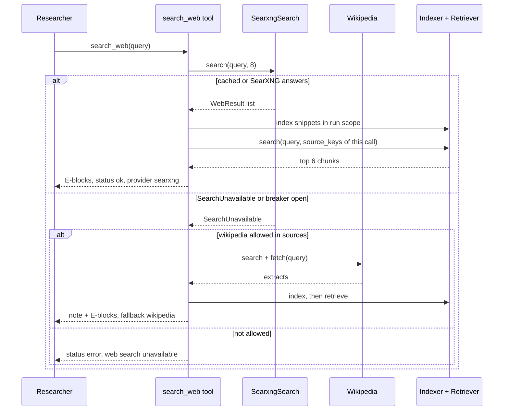
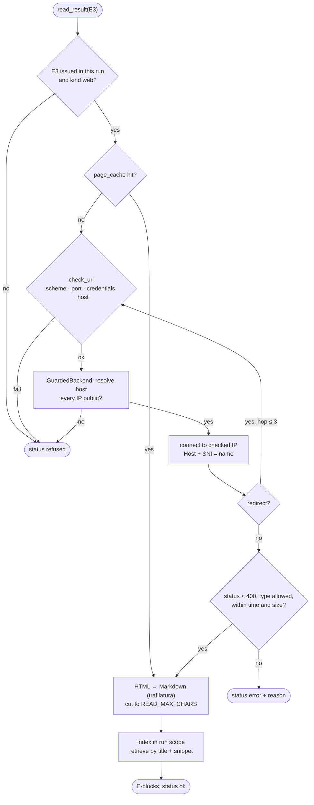

# SearXNG Tool — Detailed Plan

Web search, Wikipedia and page reading for the Researcher, plus the shared SSRF guard. Builds on the 🔒 contracts in [`../../BACKEND_PLAN.md`](../../BACKEND_PLAN.md) and the measured results in [`../../POC_SEARXNG_RAILWAY.md`](../../POC_SEARXNG_RAILWAY.md). The Researcher's loop, prompt and tool-result layout belong to `agents/RESEARCHER_PLAN.md`; this plan is what happens **inside** each tool call.

## 1. Scope and owned files

From BACKEND_PLAN §4 (owner **SEARXNG**):

| File | Content |
|---|---|
| `application/tools/web.py` | `SearchWebTool` (`search_web`), `ReadResultTool` (`read_result`) |
| `application/tools/wikipedia.py` | `SearchWikipediaTool` (`search_wikipedia`), shared Wikipedia → `SourceText` helper |
| `infrastructure/wikipedia.py` · `fake_wikipedia.py` | M5 `KnowledgeSource` adapter and fake |
| `infrastructure/searxng.py` · `fake_search.py` | `SearxngSearch` (`WebSearch` port), runtime fakes for `SEARCH_MODE=fake` |
| `infrastructure/safe_http.py` | SSRF guard: URL policy, guarded connections, `SafeHttpClient`, `SafeHttpFetcher` (`PageFetcher`) |
| `infrastructure/html_extract.py` | HTML → Markdown (`TextExtractor.html_to_markdown`) |
| `tests/unit/test_safe_http_*.py`, `tests/component/test_tools_web*.py`, `tests/integration/test_searxng.py`, … | Tests named after the area |

**In:** the three tools, the four adapters, fallback rules, caching of search results and pages, the SearXNG engine runbook, the SSRF guard API that WEBHOOKS reuses.

**Out:** the Researcher loop and the exact tool-result text (RESEARCHER), `search_documents`, chunking, `Indexer`, `Retriever` (RAG), the callback sender and its URL rules beyond the guard API (WEBHOOKS), `ServiceLevel` and `/health` wiring (Shared), the SearXNG service itself (`poc_searxng/`, already deployed).

## 2. Reuse

| Source | Use | Why |
|---|---|---|
| M5 `infrastructure/wikipedia.py` | **As-is.** `WikipediaSource`: fixed host, User-Agent, serialized + spaced requests, `TtlCache`, breaker (3 failures → 5 min), `trim_extract` | Already tested with `httpx.MockTransport`. Only rename the User-Agent to the final project |
| M5 `infrastructure/fake_wikipedia.py` | **As-is**, plus 2 articles on the demo topics (outbox pattern, webhooks) | Keeps `LLM_MODE=fake` runs sourced |
| M5 `application/workers/researcher.py` | **Dropped:** `build_query`, `STOP_WORDS`, `topics_of`, `relevant`, `_search_topics`, `_find` | The model now writes its own queries (BACKEND §11). Retrieval ranks the chunks, so the title filter is no longer needed |
| M5 `domain/ports.py` `KnowledgeSource`, `SearchHit`, `SourceDraft` | **As-is** (BACKEND §8) | |
| M5 `infrastructure/sqlite_store.py` `SqliteWikiCache` | **Pattern** for the two new cache stores (gap G6) | Same `get(key, max_age_s)` / `put` shape |
| M5 `application/security.py` `DataFence` | **As-is**, every block a tool returns goes through `wrap` | BACKEND §15 |
| M5 `tests/integration/test_wikipedia.py` `Recorder` | **Pattern** for `test_searxng.py` and `test_safe_http_client.py` | 0-network adapter tests |
| POC `poc_searxng/probe.py`, `settings.yml` | **Operations only** (§3.7) | The engine list is configuration |
| M4 | Nothing directly. Chunking and retrieval come through RAG's ports | |

## 3. Design

### 3.1 `SearxngSearch` (`infrastructure/searxng.py`)

Implements `WebSearch`: `search(query, limit) -> list[WebResult]` and `available() -> bool`.

**Request:** `GET {SEARXNG_URL}/search` with `q`, `format=json`, `language=en`, `safesearch=1`, `pageno=1`. A dedicated `httpx.Client(timeout=SEARCH_TIMEOUT_S, follow_redirects=False, trust_env=False)`. `trust_env=False` matters: the cloud and some hosts set `HTTPS_PROXY`, which must never see the private hostname. This client does **not** use `safe_http`: the URL is fixed configuration, never external input, and the guard would (correctly) refuse `*.railway.internal`.

**Response mapping** (`results[]` → `WebResult`), in SearXNG's order (it already merges and scores across engines):

| Rule | Detail |
|---|---|
| URL | Keep only `http`/`https`. Drop fragments. Skip duplicates by normalized URL (§3.4) |
| Title | `title.strip()`, whitespace collapsed, ≤ 200 chars. Empty → the URL's host |
| Snippet | `content.strip()`, collapsed, ≤ 500 chars. Results with no snippet are kept (the title may still help) but sorted after those with one |
| Engines | `tuple(engines)` (e.g. `("yahoo", "duckduckgo")`) |
| Ignored | `infoboxes`, `answers`, `suggestions`, `corrections` (the POC showed Wikipedia infoboxes; we have the real Wikipedia tool) |
| Limit | First `limit` results after the rules (`SEARCH_MAX_RESULTS` = 8) |

**Failure → `SearchUnavailable`** (gap G3): connect/read timeout, any non-200 (a 403 means the JSON format was disabled: log it once at `error`), invalid JSON, or **zero results while every configured engine is in `unresponsive_engines`** (all engines blocked is an outage, not an empty answer). Zero results with at least one engine answering is a normal **empty** list.

**Breaker:** the M5 pattern, 3 consecutive failures → open 60 s. `available()` is `True` while closed, with no network call, so `/health` costs nothing. Half-open: the next search after 60 s is a trial.

**Cache** (`search_cache`, BACKEND §16): key = `sha256("v1|" + normalize_query(query))`, value = the mapped list (≤ `SEARCH_MAX_RESULTS`) as JSON, TTL `SEARCH_CACHE_TTL_H`. Read before the breaker check, so cached queries still work during an outage. **Only non-empty results are cached:** an empty list may be a transient engine block. `normalize_query` = NFKC, casefold, collapse whitespace, strip, cut at 300 chars.

**Logs and counters** (no query text, ever): `searxng.search q_hash=<8 hex> q_len=… results=… ms=… cached=…`, and one line per `unresponsive_engines` entry with **engine name + reason only** (`yahoo: CAPTCHA`). In-process counters exposed as `stats() -> dict` (requests, failures, cache hits, unresponsive count per engine) for `/stats` (Shared wiring, optional).

### 3.2 Tools: common pipeline

Every tool is a class built once in `dependencies.py` with its ports injected, and called per step with a `ToolContext` (BACKEND §10.2):

```
validate args → provider call → SourceText list → Indexer.index → Retriever.search(run_scope, source_keys of THIS call)
             → ctx.add_evidence(chunks) → render blocks (DataFence.wrap) → ToolOutput(content, ToolCallRecord)
```

- **Retrieval is restricted to this call's sources** (`source_keys`). Otherwise earlier evidence would crowd out the new results and a rewritten query would look like it found nothing new. Already-numbered chunks keep their number (`add_evidence` contract), so repeating a search is idempotent.
- **`k = EVIDENCE_TOP_K` (6)**, each chunk's text cut to `EVIDENCE_SNIPPET_CHARS` (900) in the rendered block.
- **Never raises.** Every provider or indexing failure becomes a `ToolOutput` with `status` `error`/`refused` and a one-line, model-readable explanation. The only exceptions that escape are programming errors (caught by the Researcher as M5 does).
- **Deterministic content.** No timestamps, durations or scores in `content`, so an identical rerun produces an identical LLM request and hits the LLM cache (BACKEND §15).
- **Rendering** uses the shared `render_evidence` function (gap G8) with the layout from `RESEARCHER_PLAN.md`. Each block is `fence.wrap(text, kind, n=…, title=…, source=<domain or "Wikipedia">)`. A tool-level note (fallback, truncation) comes **before** the blocks, outside the fence, written by our code.
- **Argument validation:** `query` must be a string, 2–300 chars after collapsing whitespace. Otherwise `status="error"`, `error="query must be 2–300 characters"`, no provider call. `args` in the record are cut so the record stays ≤ 500 chars.
- **`ToolCallRecord.worker`** is `"researcher"` (the only tool user). `duration_ms` is measured around the whole call.

### 3.3 `search_web(query)` (`tools/web.py`)

1. If `search.available()`: `results = search.search(query, SEARCH_MAX_RESULTS)`. `SearchUnavailable` → step 5.
2. `results == []` → `status="empty"`, `results=0`, content: *"No web results for this query. Try different or fewer keywords."* No fallback (Open question Q1).
3. One `SourceText` per result: `scope=ctx.run_scope`, `source_kind=WEB`, `source_key=normalize_url(url)`, `title`, `url`, `text = snippet or title`. Snippets are short, so each becomes one chunk (RAG chunker); identical snippets dedupe by content hash.
4. Index, retrieve with the **query**, number, render. Record: `status="ok"`, `provider="searxng"`, `fallback=None`, `results=len(results)`, `evidence_ns`.
5. **Fallback** (SearXNG failed or its breaker is open):
   - if `wikipedia ∈ ctx.sources` (gap G1) and Wikipedia is available: run the `search_wikipedia` pipeline (§3.5) with the **same query**. Content starts with *"Web search is unavailable right now. These results come from Wikipedia."* Record: `provider="searxng"`, `fallback="wikipedia"`, `status` from the Wikipedia outcome. The evidence is of kind `wikipedia`.
   - otherwise: `status="error"`, `error="web search unavailable"`, content: *"Web search is unavailable right now. Use another tool or write findings from the evidence you have."*

`provider` always names the tool's own provider, and `fallback` names the one that actually answered, so the evaluation counts the fallback rate with one field (PLAN §12).

### 3.4 URL normalization (`tools/web.py`, pure)

`normalize_url(url)`: lower-case scheme and host, drop default ports, drop the fragment, drop tracking parameters (`utm_*`, `gclid`, `fbclid`), keep the rest of the query string in order, strip a trailing `/` on the path except for the root. It is the web `source_key`, so `read_result` can recompute it from `EvidenceRef.url` (which carries no `source_key`).

### 3.5 `search_wikipedia(query)` (`tools/wikipedia.py`)

1. `hits = knowledge.search(query, WIKI_MAX_PAGES)` (3).
2. For each hit, `knowledge.fetch([hit], WIKI_MAX_CHARS_PER_PAGE)` **one at a time**, so each `SourceDraft` stays paired with its `page_id` (M5 `fetch` silently skips empty pages, which breaks positional pairing). Cached, so the extra calls cost nothing on repeats.
3. `SourceText`: `source_kind=WIKIPEDIA`, `source_key=f"wikipedia:{page_id}"`, `title`, `url`, and `text` = the extract with MediaWiki plain-text headings (`== History ==`, `=== Early ===`) rewritten to Markdown (`## History`, `### Early`), so RAG's Markdown chunker splits by section and fills `heading`.
4. Index, retrieve with the query, number, render. Record `provider="wikipedia"`, `fallback=None`.
5. `KnowledgeUnavailable` (breaker open or request failed) → `status="error"`, `error="wikipedia unavailable"`. No hits → `status="empty"` with the rewrite hint. Wikipedia has **no** fallback: the web is a different kind of source, and the model can choose `search_web` itself.

### 3.6 `read_result(evidence_id)` (`tools/web.py`)

The model can only open a page a search already returned (PLAN §5).

1. **Parse** `evidence_id`: accepts `E3`, `e3`, `[E3]`, `3`. Anything else → `status="error"`, `error="evidence_id must look like E3"`.
2. `ref = ctx.evidence_by_n(n)`. `None` → `status="refused"`, *"E9 is not an evidence id from this run."* `ref.source_kind != WEB` or `ref.url is None` → `refused`, *"read_result opens web results only."*
3. `page = fetcher.fetch(ref.url)` (SSRF-guarded, cached). `FetchRefused` → `refused`, *"This page's address is not allowed."* `FetchFailed(reason)` → `error` with the short reason (`timeout`, `http 404`, `too large`, `unsupported type application/pdf`).
4. **Extract** by `page.media_type`: `text/html`, `application/xhtml+xml` → `extractor.html_to_markdown(page.text, page.url)`; `text/plain`, `text/markdown` → as is. PDFs are refused in v1 (gap G4, Q3). Then cut to `READ_MAX_CHARS` (60,000, gap G9) at a paragraph boundary, noting *"The page was truncated."*. Empty text → `status="empty"`, *"The page has no readable text."*
5. `SourceText`: `source_kind=WEB`, `source_key=normalize_url(ref.url)` (the **same key** as the snippet, so the page and its snippet group as one source), `title=ref.title`, `url=ref.url` (the cited address stays the one the model saw, even after redirects).
6. Index. **Retrieval query** = `ref.title + " " + snippet text` (loaded with `Retriever.get([ref.chunk_id])`): what made the model pick this result. Filter `source_keys=[key]`, drop `ref.chunk_id` itself, take `EVIDENCE_TOP_K`. (Gap G2 offers a better query.)
7. Record: `provider="web-page"`, `results` = chunks indexed from the page, `args={"evidence_id": "E3"}`.

Reading the same page twice is cheap and stable: the page cache answers, indexing dedupes by content hash, and the chunks keep their numbers.

### 3.7 Operating the engine list

| Situation | Action | Backend change |
|---|---|---|
| Normal | `keep_only: [yahoo, yandex, duckduckgo]` (POC §6) | — |
| An engine shows in `unresponsive_engines` in > 50 % of searches over a day (logs) | Run `probe.py` in the container (`railway ssh … < /dev/null`, POC §5.1) | None |
| Probe confirms the block | Remove it from `keep_only`, add a passing engine from the POC table, `railway up --service searxng`. Re-probe | None |
| < 2 engines pass | Plan B: a search API adapter behind the same `WebSearch` port (POC §6) | New adapter + config only |
| After every SearXNG redeploy | Egress IP changes (POC §5.2): re-probe once | None |
| After the first backend deploy | Check `backend → http://searxng.railway.internal:8080/healthz` from the backend container (POC "still to check") | None |

### 3.8 `html_extract.py`: library choice

Measured in this session on Python 3.12 (latest releases, fresh venvs):

| | `trafilatura` 2.3 | `readability-lxml` 0.9 + `markdownify` 1.2 |
|---|---|---|
| License | Apache-2.0 (deps Apache/BSD/MIT) | Apache-2.0 + MIT |
| Installed size | **59 MB**, 17 packages (lxml, htmldate, dateparser, justext, courlan, urllib3…) | **15 MB**, 10 packages (lxml, bs4, chardet…) |
| RAM after import + one extract | +28 MB | +29 MB |
| Output on a test page | Clean Markdown, nav/footer/script dropped | Same quality |
| Real-world quality | At or near the top of published article-extraction benchmarks, built-in Markdown output, boilerplate detection with fallbacks (justext) | Older heuristic, single maintainer, two libraries to glue |

**Recommendation: `trafilatura`** (Q2): better extraction on messy real pages, one call, one library for the architecture rule. Disk is not the constraint on Railway; RAM is, and it's equal. Call: `extract(html, url=url, output_format="markdown", include_links=False, include_images=False, include_comments=False, include_tables=True, favor_precision=True, deduplicate=True)`. `None` → `""`. **Never call `trafilatura.fetch_url`** (it would bypass the SSRF guard): an architecture test forbids it (§9).

Input is the decoded body (≤ `FETCH_MAX_BYTES`). Non-HTML types never reach this module (§3.6 step 4).

### 3.9 `safe_http.py`: the SSRF guard

**Public API** (shared with WEBHOOKS, gap G7 for the application-side check):

```python
@dataclass(frozen=True)
class UrlPolicy:
    schemes: frozenset[str]          # PAGE: {"http", "https"} · CALLBACK: {"https"}
    ports: frozenset[int] = frozenset({80, 443})
    allow_private: bool = False      # CALLBACK_ALLOW_PRIVATE (tests/local only)

PAGE_POLICY: UrlPolicy
def callback_policy(allow_private: bool) -> UrlPolicy   # https only, or http+https when allow_private

def check_url(url: str, policy: UrlPolicy) -> httpx.URL         # syntax rules, raises FetchRefused
def is_public_ip(ip: IPv4Address | IPv6Address) -> bool         # pure, the IP rules
def resolve_public(host: str, port: int, policy: UrlPolicy,
                   resolver: Resolver = system_resolver) -> list[str]   # raises FetchRefused

@dataclass(frozen=True)
class SafeResponse:
    url: str; status: int; headers: dict[str, str]; media_type: str
    body: bytes; truncated: bool

class SafeHttpClient:
    def __init__(self, timeout_s: float, max_bytes: int, max_redirects: int,
                 resolver: Resolver = system_resolver, backend: NetworkBackend | None = None) -> None
    def request(self, method: Literal["GET", "POST"], url: str, policy: UrlPolicy, *,
                content: bytes | None = None, headers: Mapping[str, str] | None = None,
                follow_redirects: bool = False) -> SafeResponse     # raises FetchRefused / FetchFailed

class SafeHttpFetcher:   # PageFetcher
    def __init__(self, client: SafeHttpClient, cache: PageCache, ttl_s: float) -> None
    def fetch(self, url: str) -> FetchedPage
```

WEBHOOKS calls `request("POST", url, callback_policy(...), content=body, headers=…, follow_redirects=False)` and maps the outcome to `SendResult`; `check_url` + `resolve_public` validate `callback_url` at submit time.

**URL rules** (`check_url`, before any network):

| Rule | Refused |
|---|---|
| Scheme | Not in `policy.schemes` |
| Credentials | Any `user:pass@` |
| Port | Explicit port not in `policy.ports` |
| Host | Empty, > 253 chars, contains a zone id (`%`), ends with `.localhost`, `.local`, `.internal`, `.arpa`, or is `localhost` (defense in depth: the IP check below catches them anyway) |
| Length | URL > 2,048 chars |

**IP rules** (`is_public_ip`), applied to **every** address the host resolves to (one bad address refuses the URL):

| Rule | Covers |
|---|---|
| `ip.is_global` required | private (10/8, 172.16/12, 192.168/16), loopback, link-local (169.254/16 incl. cloud metadata, fe80::/10), CGNAT 100.64/10, unspecified, reserved, documentation, ULA fc00::/7 (Railway's private network) |
| `not ip.is_multicast` | 224/4, ff00::/8 |
| IPv6 embedding an IPv4 | `ipv4_mapped` (::ffff:a.b.c.d), `sixtofour` (2002::/16), `teredo` server and client, NAT64 `64:ff9b::/96`: the **embedded IPv4** must itself pass |
| Odd literals | Decimal/octal/hex forms (`http://2130706433`) are caught because the rules run on the **resolved** addresses, never on the string |

`allow_private=True` skips only the IP rules (tests reach a local receiver); the scheme, port and credential rules still apply.

**Connecting to the checked IP while keeping Host and SNI.** A `GuardedBackend` implements `httpcore.NetworkBackend`. Its `connect_tcp(host, port, …)` resolves `host` itself, applies `is_public_ip` to every address, then connects the inner `httpcore.SyncBackend` to the **first checked IP**. httpcore still sends `Host: <name>` and calls `start_tls(server_hostname=<name>)`, so SNI and certificate verification use the name. Resolution and connection happen in one step, so a DNS-rebinding answer can't slip in between check and connect. The client is `httpx.Client(transport=GuardedTransport(...), trust_env=False, follow_redirects=False)`; `GuardedTransport` subclasses `httpx.HTTPTransport` and replaces its `_pool` with an `httpcore.ConnectionPool(network_backend=GuardedBackend(...))` because httpx 0.28 does not expose that parameter. A unit test asserts the private attribute exists, so an httpx upgrade fails loudly (Q4). `trust_env=False` also stops a proxy from resolving names on our behalf.

**Redirects** (pages only; webhooks never follow): a manual loop, up to `FETCH_MAX_REDIRECTS` (3). Each `Location` is resolved against the current URL and goes through `check_url` again; the backend re-checks the IP on connect. `https → http` downgrades are refused. A 4th redirect → `FetchFailed("too many redirects")`.

**Caps:**
- **Time:** httpx timeouts per phase (connect 3 s, read `timeout_s`), plus an overall deadline of `timeout_s` across all hops, checked while streaming.
- **Size:** `Content-Length > max_bytes` refuses early. The body is streamed and counted **after decompression** (`iter_bytes`), stopping at `max_bytes`. For pages a cut body is kept with `truncated=True` (HTML still extracts); for webhooks the response body is not needed and is read up to 64 KB.
- **Headers:** `User-Agent: TallerAcademyResearch/1.0 (+repo URL)`, `Accept: text/html, text/plain, text/markdown;q=0.9, */*;q=0.1`, `Accept-Encoding: gzip, deflate`. No cookies kept.

**`SafeHttpFetcher.fetch`:** `GET` with `PAGE_POLICY` and redirects on. Status ≥ 400 → `FetchFailed("http <code>")`. Media type from `Content-Type` (default `text/html` when missing and the body starts with `<`). Allowed: `text/html`, `application/xhtml+xml`, `text/plain`, `text/markdown`; anything else → `FetchFailed("unsupported type <type>")`. Decoded with the declared charset, else `charset_normalizer` (a trafilatura dependency), `errors="replace"`. Cache: `page_cache` keyed by `sha256(normalized requested URL)`, storing the final URL, the decoded text and the media type, TTL 24 h. Failures and refusals are not cached.

## 4. Contracts used

- **Types:** `SourceKind`, `EvidenceChunk`, `EvidenceRef`, `SourceText`, `RetrievedChunk`, `WebResult`, `FetchedPage`, `ToolCallRecord` (BACKEND §5.2, §5.3, §7.2, §8).
- **Ports:** `WebSearch`, `KnowledgeSource`, `PageFetcher`, `TextExtractor.html_to_markdown`, `Indexer.index`, `Retriever.search` / `get` (§7.2, §8).
- **Tools:** `Tool`, `ToolContext` (`run_scope`, `add_evidence`, `evidence_by_n`, `fence`), `ToolOutput`, the fixed names `search_web`, `search_wikipedia`, `read_result` and `read_result`'s web-only rule (§10.2).
- **Config:** `SEARCH_MODE`, `SEARXNG_URL`, `SEARCH_MAX_RESULTS`, `SEARCH_TIMEOUT_S`, `SEARCH_CACHE_TTL_H`, `FETCH_TIMEOUT_S`, `FETCH_MAX_BYTES`, `FETCH_MAX_REDIRECTS`, `EVIDENCE_TOP_K`, `EVIDENCE_SNIPPET_CHARS`, `CALLBACK_ALLOW_PRIVATE`, M5 `WIKI_*` (§6).
- **Tables:** `search_cache`, `page_cache`, M5 `wiki_cache` (§16.1). **Service level** "reduced" when search or Wikipedia is down (§15). **Fakes:** §19.2.

## 5. Diagrams

### `search_web` with fallback



### `read_result` through the guard



## 6. Failure modes and edge cases

| Case | Behavior |
|---|---|
| SearXNG timeout / 5xx / bad JSON | `SearchUnavailable` → fallback (§3.3). Breaker counts it |
| All engines unresponsive (egress IP blocked) | Treated as `SearchUnavailable` → fallback. Engine names logged |
| Zero results, engines answered | `status="empty"` + rewrite hint. Not cached |
| SearXNG returns 403 | JSON format disabled in `settings.yml`: `error` log once, `SearchUnavailable` |
| Breaker open | No request; cached queries still answer; others go to fallback |
| Results with duplicate URLs / no snippet / non-http URLs | Deduped / sorted last / dropped (§3.1) |
| Wikipedia down during fallback | `status="error"`, both providers named in `error` |
| Model passes an unknown arg or a wrong type | Assumed: `ToolBox` validates against the spec first. The tool re-checks `query`/`evidence_id` |
| `read_result` on a Wikipedia or document evidence | `refused` with the reason (§3.6) |
| Page is a PDF, image, binary | `error` `unsupported type …` (v1) |
| Page > 2 MB | Body cut at `FETCH_MAX_BYTES`, extracted anyway, note added |
| Page is mostly script (SPA), extract empty | `status="empty"`, *"no readable text"*: the model moves on |
| Redirect to a private IP / downgrade to http / 4th hop | `refused` / `refused` / `error` |
| DNS name with one public and one private address | `refused` (every address must pass) |
| Gzip bomb | Decompressed bytes counted, stops at the cap |
| Embedder still loading (BACKEND §17) | `Indexer` waits up to 10 s, then the tool returns `error` *"search index warming up"* |
| Two parallel Researcher tasks index the same URL | `Indexer` lock + content-hash dedup → same chunk ids, same E numbers |

## 7. Security

- **Content is data.** Snippets, extracts and pages go only into `DataFence.wrap` blocks. Titles are attributes (`_attr` escapes quotes, ≤ 200 chars). The tool's own notes sit outside the fence and contain no external text.
- **No model-chosen URLs.** `read_result` takes an evidence id that the run issued; the URL comes from our own stored `EvidenceRef`.
- **SSRF:** §3.9 in full. The private SearXNG URL and Railway's `fd12::/16` private range are unreachable through the guard; SearXNG itself is reached only by its own fixed-URL client.
- **No execution:** trafilatura parses with lxml and drops `<script>`; nothing is rendered or run. No cookies, no auth headers forwarded.
- **Privacy:** queries go to Yahoo, Yandex, DuckDuckGo (through SearXNG) and Wikipedia; pages are fetched from their hosts. Covered by the privacy notice (PLAN §13).
- **Logs:** query hashes and lengths, hosts (never full URLs with query strings), counts, durations, engine names. Never page text.
- **Injection test data:** the runtime fake fetcher includes a page with a planted *"ignore previous instructions"* line; tests check it arrives fenced and unchanged.

## 8. Cost

**0 Gemini calls** in this area: SearXNG, Wikipedia, fetching, extraction, indexing and retrieval are all local or free. The area's effect on cost is **input tokens**: one tool result ≈ 6 blocks × ≤ 900 chars ≈ 1,500 tokens, so a Researcher task with 3 tool calls adds ≈ 4,500 input tokens across its later calls.

**Caching keeps reruns at 0 calls:** `search_cache` (24 h) and `page_cache` (24 h) make tool results byte-identical on a rerun, and deterministic rendering (§3.2) lets the LLM response cache (keyed on tool results) hit. Wikipedia keeps its M5 7-day cache.

## 9. Tests

All with 0 network: `httpx.MockTransport`, fake resolvers, fake network backends, and the BACKEND §19.2 fakes (`FakeWebSearch`, `FakeWikipedia`, `FakePageFetcher`, `HashingEmbedder`, `InMemoryVectorStore`).

| Suite | Cases |
|---|---|
| **Unit** `test_safe_http_rules.py` | `is_public_ip` table: every range in §3.9, IPv4-mapped/6to4/Teredo/NAT64 with private and public embeds, `fd12::1`, `169.254.169.254`, `100.64.0.1`, a public v4 and v6. `check_url`: schemes per policy, credentials, ports 80/443/8080, `localhost`/`.internal`/zone ids, 2,049-char URL |
| **Unit** `test_safe_http_client.py` | Fake resolver + recording inner backend: connects to the checked IP, `start_tls` gets `server_hostname=<name>`; mixed public/private answer refused; rebinding (second resolution private) refused at connect; redirect to private refused; https→http refused; 4 hops; `Content-Length` too big; streamed body cut and `truncated=True`; gzip bomb stops at cap; overall deadline (fake clock); `trust_env` is off; `_pool` attribute present |
| **Unit** `test_web_helpers.py` | `normalize_url`, `normalize_query`, evidence id parsing, MediaWiki heading rewrite, paragraph-boundary cut |
| **Integration** `test_searxng.py` | Recorded JSON responses: mapping rules, dedup, limit, `unresponsive_engines` all → `SearchUnavailable`, some → results, 403, timeout, bad JSON, breaker open/half-open, cache hit skips HTTP, empty not cached, no query text in logs (caplog) |
| **Integration** `test_html_extract.py` | Article page, nav/footer dropped, tables kept, script dropped, injection line kept as text, empty SPA page → `""`, non-UTF-8 page |
| **Integration** `test_wikipedia.py` | M5 K1–K5 kept as is |
| **Component** `test_tools_web.py` | `search_web` ok (record fields, E numbers, fence nonce in content), empty, fallback to Wikipedia (note + `fallback="wikipedia"`), fallback not allowed, both down, bad query arg, rerun gives identical `content`, retrieval limited to this call's `source_keys` |
| **Component** `test_tools_read_result.py` | ok on HTML and text/plain, unknown id, non-web id, refused URL, http 404, unsupported type, empty page, truncation note, same page twice → same E numbers, snippet chunk excluded |
| **Component** `test_tools_wikipedia.py` | ok with 2 pages (source keys `wikipedia:<id>`), empty, down, page with empty extract skipped |
| **Architecture** (Shared file, rules requested in G10) | `trafilatura` only in `html_extract.py`; `httpcore` only in `safe_http.py`; no `fetch_url` anywhere |

Coverage ≥ 90 % for the owned files, Ruff clean.

## 10. Contract gaps

| # | Needed change | Why | Smallest alternative |
|---|---|---|---|
| G1 | `ToolContext.sources: frozenset[SourceKind]` (additive, default all) | `search_web` must know whether the Wikipedia fallback is allowed by the run's `sources` | Build the tool objects per run in `ToolBox` with the flag. More wiring, same result |
| G2 | `ToolContext.focus: str \| None = None` (additive), the Researcher's TASK | A better retrieval query for `read_result` than title + snippet | None needed: v1 uses title + snippet (§3.6) |
| G3 | `domain/errors.py`: `SearchUnavailable`, `FetchRefused`, `FetchFailed(reason)` (additive) | Named by BACKEND §17/§19.2 but not defined. Application code must catch them without importing infrastructure | — |
| G4 | `FetchedPage.data: bytes \| None = None` (additive) | `pdf_to_text(data)` needs bytes; `FetchedPage.text` can't carry a PDF | v1 refuses PDFs in `read_result` (Q3) |
| G5 | `TextExtractor` is one Protocol spanning `html_extract` (SEARXNG) and `pdf_extract` (RAG). Phase 1 adds a small composite adapter in `dependencies.py` | No single owner can implement both methods | Tools depend only on `html_to_markdown`; RAG on `pdf_to_text` |
| G6 | `sqlite_store.py` (Shared): `SqliteSearchCache` (`get(key, max_age_s) -> list[dict] \| None`, `put(key, value)`) and `SqlitePageCache` (`get(url_hash, max_age_s) -> (url, text, media_type) \| None`, `put(...)`) | `sqlite3` may only be imported in the SQLite modules; the tables exist but their stores aren't assigned | Store pages as JSON in a generic TTL cache (but `page_cache` already has typed columns) |
| G7 | RunService (application) validates `callback_url` (BACKEND §13) but can't import `safe_http`. Inject `url_check: Callable[[str], None]` (raising `FetchRefused`) in `dependencies.py` | Layer rule (BACKEND §3) | A `UrlGuard` port in `ports.py` |
| G8 | `tools/base.py` (Shared): `render_evidence(refs, chunks, fence, note) -> str`, layout from `RESEARCHER_PLAN.md` | Three owners' tools (mine + `search_documents`) must render identical blocks | Each tool copies the layout (drift risk) |
| G9 | Config (additive): `READ_MAX_CHARS=60000` | Caps extracted page text before chunking (time, RAM, chunk count) | A constant in `tools/web.py` |
| G10 | Architecture tests: add `httpcore` (only `safe_http.py`) and a ban on `trafilatura.fetch_url` | The guard depends on owning every outbound connection | Code review only |

`SEARCH_MODE=fake` also selects the runtime fake page fetcher (`fake_search.py`); no new `FETCH_MODE` variable.

## 11. Open questions

> **Review decisions (2026-10-11), recorded in [BACKEND_PLAN §24](../../BACKEND_PLAN.md#24-plan-review-accepted-changes-contracts-v11):** Q1 accepted (fall back on failure only, and only when `wikipedia` ∈ `sources`), Q2 `trafilatura` accepted, Q3/Q5/Q6 accepted. **Q4 not accepted:** no private httpx attribute in security code; use the alternative, an `httpx.BaseTransport` over `httpcore.ConnectionPool(network_backend=GuardedBackend(...))`. Gaps G1–G10 accepted (G5: two ports, `HtmlExtractor` and `PdfExtractor`).

| # | Question | Recommendation |
|---|---|---|
| Q1 | PLAN §5's diagram falls back to Wikipedia when SearXNG is "down **or empty**"; the POC says empty results are for the Researcher to react to | **Fall back only on failure** (incl. all engines blocked). Empty → the model rewrites the query, which is the agentic behavior the evaluator looks for. Update the PLAN diagram label |
| Q2 | HTML extractor | **`trafilatura`** (§3.8). Pin in phase 0 |
| Q3 | PDFs behind web results | **Refuse in v1**, add G4 later if the evaluation shows PDF results are common |
| Q4 | `GuardedTransport` touches httpx's private `_pool` | **Accept** with a pinned httpx and the attribute test. Alternative: a ~40-line `httpx.BaseTransport` over `httpcore.ConnectionPool` (no private access, more code) |
| Q5 | Should `/health` ping SearXNG's `/healthz` instead of reading the breaker? | **Breaker only** (no network per health check). The post-deploy check covers reachability |
| Q6 | Railway's private network may resolve to IPv6 only; SearXNG must listen on `::` | **Check at deploy** (§3.7 last row). If it fails, set SearXNG's bind address in its service settings |

## 12. Implementation steps

1. **Pure helpers** (`normalize_url`, `normalize_query`, evidence-id parser, heading rewrite) + unit tests.
2. **`safe_http` rules:** `UrlPolicy`, `check_url`, `is_public_ip`, `resolve_public` + the rule table tests.
3. **`safe_http` client:** `GuardedBackend`, `GuardedTransport`, `SafeHttpClient.request` (redirects, caps, deadline) + client tests with fake resolver/backend.
4. **`SafeHttpFetcher`** with media-type rules, decoding and page cache (G6) + tests.
5. **`html_extract.py`** with trafilatura + fixture tests.
6. **`SearxngSearch`** (mapping, errors, breaker, cache, stats) + recorded-response tests. **`fake_search.py`:** `FakeSearxng` (built-in results on the demo topics) and `FakeSitePageFetcher` (canned pages, one with the planted injection).
7. **`search_wikipedia` tool** on M5 `WikipediaSource` + component tests.
8. **`search_web` tool** incl. fallback + component tests.
9. **`read_result` tool** + component tests.
10. **Wiring notes** for `dependencies.py` (Shared, phase 1): adapters by `SEARCH_MODE`, the `TextExtractor` composite (G5), `url_check` (G7), `ServiceLevel` search flag, `/health` `search` field.
11. **Full suite, coverage ≥ 90 %, Ruff**; record any deviation in a "Deviations" section here.
